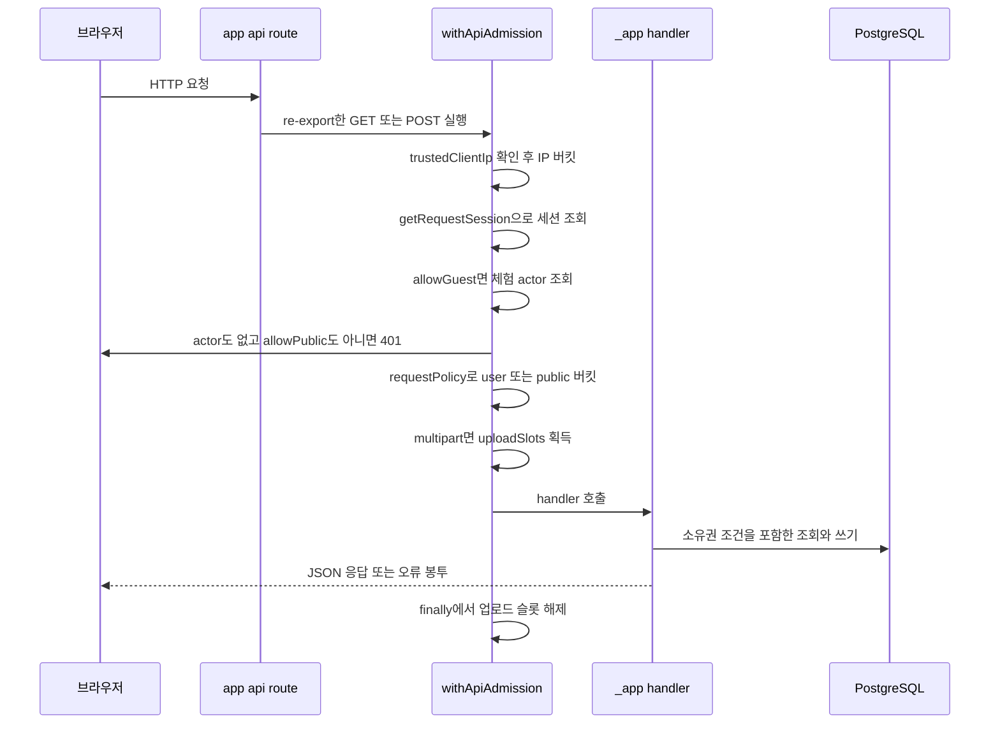

새 API를 추가할 때는 route 파일에 `runtime` 선언과 re-export만 두고, handler를 `withApiAdmission`으로 감싼 뒤 같은 그룹의 오류 봉투를 그대로 따르세요. 400·401·413·429 응답을 해석할 때는 어느 게이트가 먼저 거절했는지와 어느 봉투가 돌아왔는지를 이 페이지에서 확인하면 돼요.

브라우저가 보내는 요청은 [app/api/mixing-jobs/route.ts](repo://app/api/mixing-jobs/route.ts#L1-L3) 같은 Route Handler가 받아 `src/_app/api-routes/**`의 handler로 넘기고, 그 사이에서 세션 확인과 요청 제한이 먼저 적용돼요. 이 페이지는 요청 제한 수치, 업로드 본문 한도, 오류 봉투, adapter 규약, `Idempotency-Key`·`Origin` 검사 위치를 다뤄요. 세션과 관리자 권한의 판정 규칙은 [인증과 소유권 경계](../integrations/auth-and-ownership.md)가, 큐 용량·lease 규칙은 [Job 큐와 lease 복구 계약](../operations/job-processing.md)이, 비회원 체험의 상태 판정과 전이는 [비회원 체험 분석 흐름](../workflows/guest-analysis-trial.md)이 소유해요. 두 봉투를 브라우저가 어떻게 흡수하는지는 [브라우저 상태와 API 오류 계약](client-data-flow.md)에 있어요.

## 요청 처리 경로와 adapter 규약

`app/api/**/route.ts`는 구현을 담지 않는 얇은 adapter예요. 각 파일은 route config를 선언하고 `src/_app/api-routes/**/index.server.ts`의 handler를 HTTP 메서드 이름으로 re-export하는 두 문장 정도로 끝나요.

```ts
export const runtime = "nodejs";

export { mixingJobsGet as GET, mixingJobsPost as POST } from "@/_app/api-routes/mixing-jobs/index.server";
```

현재 트리의 `app/api/**/route.ts`는 37개이고, 그중 31개가 `export const runtime = "nodejs"`를 선언해요. 선언이 없는 6개는 `app/api/admin/custom-mixing/` 아래 4개(`route.ts`, `profiles/route.ts`, `[id]/route.ts`, `[id]/audio/route.ts`)와 비회원 체험 2개([app/api/guest-analysis/route.ts](repo://app/api/guest-analysis/route.ts#L1-L1), [app/api/guest-analysis/claim/route.ts](repo://app/api/guest-analysis/claim/route.ts#L1-L1))예요. 37개 파일의 모듈 참조는 모두 `@/_app/api-routes/**` re-export 하나뿐이라, Prisma나 `node:*` 같은 server 모듈이 route 계층으로 새지 않아요.

이 구조는 관례이면서 검증 대상이에요. [tests/fsd-architecture-boundaries.test.ts](repo://tests/fsd-architecture-boundaries.test.ts#L278-L310)가 `app/` 아래 파일에 세 가지 규칙을 적용해요.

| 규칙 | 위반으로 잡히는 문장·참조 | 검사 범위 |
| --- | --- | --- |
| public API 밖 import | `@/`나 `.`로 시작하는 참조가 `src/_app`·`src/_pages` public API(`index.*.ts`) 밖을 가리켜요 | [L283-L292](repo://tests/fsd-architecture-boundaries.test.ts#L283-L292) |
| import·export·directive 외의 문장 | `import` 문, `export` 문, directive 문자열 문장이 아닌 statement예요(예: 함수 선언) | [L294-L306](repo://tests/fsd-architecture-boundaries.test.ts#L294-L306), fixture 확인 [L360-L379](repo://tests/fsd-architecture-boundaries.test.ts#L360-L379) |
| 정적 route config가 아닌 변수 선언 | export 표시가 없거나, 이름이 아래 목록의 route config 이름이 아니거나, 값이 정적 리터럴이 아닌 변수 선언이에요 | [L294-L306](repo://tests/fsd-architecture-boundaries.test.ts#L294-L306), [정적 값 판정](repo://tests/fsd-architecture-boundaries.test.ts#L235-L253) |

세 번째 규칙이 route config로 인정하는 이름은 다음 일곱 개예요([L28-L36](repo://tests/fsd-architecture-boundaries.test.ts#L28-L36)).

- `runtime`
- `preferredRegion`
- `dynamic`
- `dynamicParams`
- `revalidate`
- `fetchCache`
- `maxDuration`



그림: 브라우저 요청이 adapter와 admission 래퍼를 지나 handler까지 도달하는 순서예요. actor를 확보하지 못하면 handler 본문에 도달하지 않고 401 봉투가 나가요.

## admission(요청 제한)의 게이트 순서

`withApiAdmission`은 handler를 호출하기 전에 정해진 순서로 검사해요([src/_app/api-routes/admission.ts](repo://src/_app/api-routes/admission.ts#L11-L38)). 두 번째 인자로 받는 옵션이 "세션 없이 어디까지 통과시킬지"를 정해요.

| 단계 | 하는 일 | 실패 시 |
| --- | --- | --- |
| 1 | `trustedClientIp`가 값을 반환하면 `ip:${ip}` 버킷 600/120을 소비해요 | `RATE_LIMITED` 429 · `LIMITER_CAPACITY` 503 |
| 2 | `getRequestSession`으로 세션을 확인하고, 없고 `allowGuest`면 `getAnalysisActor`로 체험 identity를 찾아요 | - |
| 3 | actor도 없고 `allowPublic`도 아니면 `unauthorizedResponse()`를 반환해요 | `UNAUTHENTICATED` 401 |
| 4 | `requestPolicy(path, method)`가 정한 그룹 버킷을 소비해요. 키는 actor가 있으면 `user:${userId}:${group}`, 없으면 `public:${ip ?? "untrusted-ingress"}:${group}`이에요 | 그룹 rate/burst 초과 시 429 |
| 5 | `Content-Type`이 `multipart/form-data`로 시작하면 업로드 슬롯을 잡아요. 키는 actor의 `userId`, 없으면 `public:...`이에요 | `UPLOAD_ALREADY_ACTIVE` 429 · `UPLOAD_CAPACITY` 503 |
| 6 | handler를 호출하고, `finally`에서 슬롯을 해제해요 | `AdmissionError`는 `admissionResponse`로 변환 |

옵션 두 개의 의미는 서로 달라요. `allowGuest`는 세션이 없을 때 체험 쿠키로 actor를 채우고, 그 actor의 `userId`로 그룹 버킷과 업로드 슬롯을 세요. `allowPublic`은 actor가 아예 없어도 401로 끊지 않고 `public:` 키로 버킷만 적용해요. 두 옵션은 독립이라, `allowPublic`만 켜면 익명 요청은 통과하지만 체험 쿠키가 있어도 `public:` 키로 계산돼요. 현재 코드에는 그런 조합이 없고, 두 옵션을 함께 켠 곳도 아래 GET 한 곳뿐이에요.

| 옵션 조합 | 세션 없음 + 체험 쿠키 없음 | 세션 없음 + 체험 쿠키 있음 | 세션 있음 |
| --- | --- | --- | --- |
| 옵션 없음(기본) | 401 | 401 | handler 호출 |
| `allowGuest` | 401 | 체험 `userId` actor로 통과 | 회원 `userId` actor로 통과 |
| `allowGuest` + `allowPublic` | `public:` 버킷으로 통과 | 체험 `userId` actor로 통과 | 회원 `userId` actor로 통과 |

`allowPublic`은 현재 `/api/vocal-profile-analysis-jobs` GET 한 곳에만 붙어 있어요([vocal-profile-analysis-jobs-route.ts](repo://src/_app/api-routes/vocal-profiles/vocal-profile-analysis-jobs-route.ts#L160-L162)). 체험 쿠키가 없는 방문자도 분석 정책을 조회할 수 있게 하려는 구성이고, 응답에는 `Cache-Control: no-store`가 붙어요. 체험 actor를 어떻게 판정하고 어떤 상태 값을 돌려주는지는 [비회원 체험 분석 흐름](../workflows/guest-analysis-trial.md)이 설명해요.

`withAuthAdmission`은 이 래퍼를 쓰지 않는 별도 경로예요. IP 버킷 없이 `auth:${ip ?? "untrusted-ingress"}` 버킷 120/30만 소비하고 handler를 호출해요([admission.ts](repo://src/_app/api-routes/admission.ts#L41-L50)). Better Auth 처리 경로와 health 확인이 이 래퍼를 써요.

그룹은 `requestPolicy`가 정해요([src/shared/lib/admission/limiter.ts](repo://src/shared/lib/admission/limiter.ts#L60-L68)).

| 그룹 | 매칭 조건 | rate(분당 토큰) | burst |
| --- | --- | --- | --- |
| `audio` | 경로가 `/audio`, `/reference`, `/synthesis-reference`로 끝남 | 240 | 60 |
| `submission` | POST이면서 경로에 `mixing-jobs`, `vocal-profiles`, `vocal-profile-analysis-jobs` 포함 | 6 | 3 |
| `admin-write` | `/api/admin/`로 시작하고 메서드가 GET·HEAD가 아님 | 10 | 3 |
| `recommendation` | `/api/recommendations`로 시작 | 30 | 10 |
| `read` | 위 조건에 해당하지 않는 나머지 | 180 | 60 |

그룹 판정은 위에서 아래 순서로 먼저 맞는 조건을 채택해요. 그래서 `/api/admin/...` 경로라도 `/audio`로 끝나면 `audio` 그룹이 되고, 관리자 조회(`GET`)는 `read` 그룹으로 계산돼요. `/api/guest-analysis`와 `/api/guest-analysis/claim`은 어느 특수 조건에도 걸리지 않아 `read` 그룹이에요.

| 버킷 | 키 | rate / burst | 적용 조건 |
| --- | --- | --- | --- |
| IP 버킷 | `ip:${ip}` | 600 / 120 | `trustedClientIp`가 값을 반환할 때만 |
| 사용자 그룹 버킷 | `user:${userId}:${group}` | 그룹 표 값 | actor가 확인된 뒤 |
| 공개 그룹 버킷 | `public:${ip ?? "untrusted-ingress"}:${group}` | 그룹 표 값 | actor가 없지만 `allowPublic`인 경로 |
| 인증 버킷 | `auth:${ip ?? "untrusted-ingress"}` | 120 / 30 | `withAuthAdmission` 경로(`/api/auth/[...all]`, `/api/vocal-profiles/health`) |
| 체험 시작 버킷 | `guest-start:${ip ?? "untrusted-ingress"}` | 6 / 3 | `/api/guest-analysis` POST |
| 업로드 슬롯 | 사용자 단위 1개, 전체 `UPLOAD_CONCURRENCY`(기본 2, 허용 1~20) | - | `multipart/form-data` 요청 |

`trustedClientIp`는 `TRUST_PROXY_CLIENT_IP`가 정확히 `"true"`일 때만 동작해요. 그때 `TRUSTED_CLIENT_IP_HEADER`가 지정한 헤더 값을 읽고, 값이 없거나 `isIP` 검증을 통과하지 못하면 `null`을 반환해요. 변수를 켜 두고 헤더 이름을 비워 두면 오류를 던져요([limiter.ts](repo://src/shared/lib/admission/limiter.ts#L49-L55)). 프록시를 신뢰하지 않는 기본 구성에서는 IP 버킷이 항상 건너뛰어지고, `withAuthAdmission` 경로와 `public:` 키를 쓰는 경로는 모든 요청이 버킷 하나를 공유해요. 그래서 기본 구성에서 익명 `GET /api/vocal-profile-analysis-jobs`는 전원이 같은 `public:untrusted-ingress:read` 버킷을 나눠 써요.

`TokenBuckets`는 항목 수 상한 10,000개를 두고, 새 키를 추가할 때 10분 넘게 갱신되지 않은 항목을 먼저 정리해요. 정리 후에도 가득 차 있으면 `LIMITER_CAPACITY` 503을 던져요. 토큰이 1개 미만이면 `RATE_LIMITED` 429를 던지고, 재시도 대기 시간을 `max(1, ceil((1 - 토큰 수) * 60 / rate))`초로 계산해요([limiter.ts](repo://src/shared/lib/admission/limiter.ts#L14-L33)). 업로드 슬롯은 같은 사용자의 동시 업로드를 `UPLOAD_ALREADY_ACTIVE` 429로 막고, 전체 슬롯이 차면 `UPLOAD_CAPACITY` 503을 던져요([limiter.ts](repo://src/shared/lib/admission/limiter.ts#L36-L47)). 환경 변수 이름과 기본값은 [환경 변수와 런타임 한도](../operations/configuration.md)에 모여 있어요.

`/api/guest-analysis` POST는 `withApiAdmission`을 쓰지 않고 자체 게이트를 가져요([guest-analysis-route.ts](repo://src/_app/api-routes/guest-analysis/guest-analysis-route.ts#L19-L44)). 같은 출처 검사 후 `guest-start:` 버킷 6/3을 소비하고, 세션이 있으면 `{ status: "member" }`를, 이미 체험 기록이 있으면 `{ status: "ready" }`를 반환해요. 새 체험을 만들 때는 프로세스 메모리 일일 한도([src/shared/lib/admission/guest-quota.ts](repo://src/shared/lib/admission/guest-quota.ts#L18-L39), `GUEST_ANALYSIS_DAILY_LIMIT` 기본 10)를 확인하고, 한도가 없으면 `admissionResponse`로 429를 돌려줘요.

큐 용량은 이 래퍼가 아니라 작업을 접수하는 트랜잭션 안에서 검사해요. 접수 함수는 advisory transaction lock으로 직렬화한 뒤 전역·사용자 큐 한도를 확인하고, 초과하면 같은 `AdmissionError`를 던져요([src/shared/lib/admission/queue.ts](repo://src/shared/lib/admission/queue.ts#L7-L23)). 그래서 동시 POST 두 건이 같은 작업을 중복 생성하지 않아요. 상태 집합과 재시도 규칙은 [Job 큐와 lease 복구 계약](../operations/job-processing.md)을 보세요.

## API 그룹 표면

세션 요구는 래퍼 옵션으로 정해지고, handler 안에서 `requireApiSession`이나 `requireAdminApi`로 한 번 더 확인하는 경우도 있어요.

| 경로 그룹 | 메서드 | 대표 handler | 게이트 |
| --- | --- | --- | --- |
| `/api/auth/[...all]` | GET, POST | [auth-route.ts](repo://src/_app/api-routes/auth/auth-route.ts#L1-L7) | `withAuthAdmission`, 세션 검사 없음(인증 흐름 자체) |
| `/api/vocal-profiles/health` | GET | [vocal-profile-health-route.ts](repo://src/_app/api-routes/vocal-profiles/vocal-profile-health-route.ts#L5-L20) | `withAuthAdmission`, 세션 검사 없음 |
| `/api/guest-analysis` | POST | [guest-analysis-route.ts](repo://src/_app/api-routes/guest-analysis/guest-analysis-route.ts#L19-L44) | 자체 게이트(같은 출처 + `guest-start` 버킷), 세션 없어도 동작 |
| `/api/guest-analysis/claim` | POST | [guest-analysis-claim-route.ts](repo://src/_app/api-routes/guest-analysis/guest-analysis-claim-route.ts#L6-L27) | 세션 필요(`withApiAdmission` 기본 옵션, handler도 `requireApiSession` 확인) |
| `/api/vocal-profile-analysis-jobs`, `/[id]` | GET, POST | [vocal-profile-analysis-jobs-route.ts](repo://src/_app/api-routes/vocal-profiles/vocal-profile-analysis-jobs-route.ts#L96-L162), [analysis-job-detail-route.ts](repo://src/_app/api-routes/vocal-profiles/vocal-profile-analysis-job-detail-route.ts#L7-L23) | GET은 `allowGuest`+`allowPublic`, POST는 `allowGuest` |
| `/api/vocal-profiles`, `/[id]` | GET, POST, PATCH, DELETE | [vocal-profiles-route.ts](repo://src/_app/api-routes/vocal-profiles/vocal-profiles-route.ts#L17-L100), [vocal-profile-detail-route.ts](repo://src/_app/api-routes/vocal-profiles/vocal-profile-detail-route.ts#L22-L128) | GET·DELETE는 `allowGuest`, POST·PATCH는 세션 필요 |
| `/api/vocal-profiles/[id]/audio`, `/[id]/synthesis-reference/audio` | GET | [vocal-profile-audio-route.ts](repo://src/_app/api-routes/vocal-profiles/vocal-profile-audio-route.ts#L7-L34), [synthesis-reference audio](repo://src/_app/api-routes/vocal-profiles/vocal-profile-synthesis-reference-audio-route.ts#L1-L44) | `allowGuest` |
| `/api/recommendations`, `/[id]` | POST, GET | [recommendations-route.ts](repo://src/_app/api-routes/recommendations/recommendations-route.ts#L29-L53), [recommendation-detail-route.ts](repo://src/_app/api-routes/recommendations/recommendation-detail-route.ts#L22-L38) | `allowGuest` |
| `/api/mixing-jobs`, `/[id]`, `/[id]/audio` | GET, POST, DELETE | [mixing-jobs-route.ts](repo://src/_app/api-routes/mixing-jobs/mixing-jobs-route.ts#L15-L76), [mixing-job-detail-route.ts](repo://src/_app/api-routes/mixing-jobs/mixing-job-detail-route.ts#L6-L50), [mixing-job-audio-route.ts](repo://src/_app/api-routes/mixing-jobs/mixing-job-audio-route.ts#L5-L40) | 세션 필요 |
| `/api/account/tickets`, `/api/account/ticket-balance`, `/api/account/onboarding/completion` | GET, POST | [tickets-route.ts](repo://src/_app/api-routes/account/tickets-route.ts#L5-L17), [ticket-balance-route.ts](repo://src/_app/api-routes/account/ticket-balance-route.ts#L5-L11), [onboarding-completion-route.ts](repo://src/_app/api-routes/account/onboarding-completion-route.ts#L5-L11) | 세션 필요 |
| `/api/notifications`, `/[id]`, `/read-all` | GET, PATCH, POST | [notifications-route.ts](repo://src/_app/api-routes/notifications/notifications-route.ts#L5-L17), [notification-read-route.ts](repo://src/_app/api-routes/notifications/notification-read-route.ts#L6-L19), [notifications-read-all-route.ts](repo://src/_app/api-routes/notifications/notifications-read-all-route.ts#L5-L11) | 세션 필요 |
| `/api/admin/*`(catalog, custom-mixing, mixing-jobs, overview, ticket-adjustments, users) | GET, POST, DELETE | [catalog-route.ts](repo://src/_app/api-routes/admin/catalog/catalog-route.ts#L13-L50), [admin index.server.ts](repo://src/_app/api-routes/admin/index.server.ts#L1-L7) | 세션 + 관리자 이메일 allowlist(거부 시 403) |

세션 외에 소유권 조건이 하나 더 붙어요. 예를 들어 믹싱 작업 상세 handler는 `getMixingJobForUser(session.user.id, id)`를 호출하고, 조회 함수가 `findFirst({ where: { id, userId } })`로 소유자를 조건에 넣어요([mixing-job-detail-route.ts](repo://src/_app/api-routes/mixing-jobs/mixing-job-detail-route.ts#L6-L14), [history.ts](repo://src/entities/mixing-job/api/history.ts#L152-L155)). 그래서 남의 자원이면 존재 여부를 구분하지 않고 404를 반환해요. 관리자 경계도 같은 handler 안에서 `requireAdminApi`로 검사하고, 응답이 있으면 그대로 반환해요([catalog-route.ts](repo://src/_app/api-routes/admin/catalog/catalog-route.ts#L13-L23)). 권한 정책 자체는 [인증과 소유권 경계](../integrations/auth-and-ownership.md)를 보세요.

오디오 파일 경로(`/[id]/audio`, `/[id]/synthesis-reference/audio`)는 외부 저장소 URL을 노출하지 않고 server에서 bytes를 중계해요. `Range` 요청 전달과 캐시 헤더 처리는 [미디어 저장과 정리 의도](../operations/media-storage.md)가 설명해요. `/api/admin/catalog/export`는 JSON 본문 대신 `Content-Disposition: attachment`가 붙은 파일 다운로드로 응답해요([export-route.ts](repo://src/_app/api-routes/admin/catalog/export-route.ts#L6-L22)).

## 업로드와 본문 크기 한도

multipart 요청은 `multipartBodyLimit(fileLimitBytes)` = 파일 상한 + 1MiB로 계산해요. 1MiB는 multipart 경계·헤더 오버헤드 몫이에요([src/shared/api/multipart.server.ts](repo://src/shared/api/multipart.server.ts#L11-L25)). 상한은 선언된 `Content-Length`로 한 번, 스트림을 읽으면서 누적 바이트로 다시 한 번 확인하고, 초과하면 `MultipartBodyTooLargeError`를 던져요. 읽기 전체에는 `runtimeLimits().uploadMs`(기본 180,000ms) 타임아웃이 걸리고, 클라이언트가 연결을 끊으면 `request.signal`로 읽기를 취소해요([multipart.server.ts](repo://src/shared/api/multipart.server.ts#L27-L74)).

| 대상 | 파일 상한 | 실제 본문 상한 | 초과 시 응답 | 근거 |
| --- | --- | --- | --- | --- |
| 보컬 프로필 분석 오디오 | 25MiB | 25MiB + 1MiB | `PAYLOAD_TOO_LARGE` 413(`reasonCode`) | [contract.ts](repo://src/features/analyze-vocal-profile/model/contract.ts#L4-L14) |
| 관리자 곡 target 음원 | 49,000,000 bytes | 49,000,000 + 1MiB | `PAYLOAD_TOO_LARGE` 413(`error` 객체) | [target-assets.ts](repo://src/features/manage-song-catalog/api/target-assets.ts#L10-L28), [catalog/http.ts](repo://src/_app/api-routes/admin/catalog/http.ts#L13-L22) |
| 카탈로그 스냅샷 import | 20MiB | 20MiB + 1MiB | `SNAPSHOT_TOO_LARGE` 400(`error` 객체) | [import-route.ts](repo://src/_app/api-routes/admin/catalog/import-route.ts#L12-L39) |
| admin custom mixing target | 256MiB | 256MiB + 1MiB | `detail`만 있는 400 | [contract.ts](repo://src/features/admin-custom-mixing/model/contract.ts#L3-L7), [custom-mixing-route.ts](repo://src/_app/api-routes/admin/custom-mixing/custom-mixing-route.ts#L29-L37) |
| JSON 본문 | 해당 없음 | 1MiB | 라우트가 400으로 변환 | [multipart.server.ts](repo://src/shared/api/multipart.server.ts#L76-L79) |

같은 종류의 초과라도 413과 400이 갈리는 이유는 변환 지점이 다르기 때문이에요. 분석 접수 경로는 `MultipartBodyTooLargeError`를 `PAYLOAD_TOO_LARGE` 413으로 바꾸고, 관리자 catalog 음원은 `SongCatalogAdminError("PAYLOAD_TOO_LARGE", ..., 413)`으로, 스냅샷 import와 custom-mixing은 400 봉투로 바꿔요. 413을 해석할 때는 어느 route가 만든 응답인지 먼저 확인하세요.

JSON 본문은 `readBoundedJson`이 같은 리더를 1MiB 상한과 `runtimeLimits().metadataMs`(기본 15,000ms) 타임아웃으로 호출한 뒤 `JSON.parse`해요([multipart.server.ts](repo://src/shared/api/multipart.server.ts#L76-L79)). 라우트가 `readBoundedJson(request).catch(() => null)` 형태로 감싸는 이유는 파싱 실패를 400 봉투로 바꾸기 위해서예요.

Route Handler와 별개로 Server Action에는 Next.js 설정 상한이 하나 더 있어요. [next.config.ts](repo://next.config.ts#L3-L10)가 `experimental.serverActions.bodySizeLimit`을 `"300mb"`로 올리고, 주석에 "Keep large audio Server Actions aligned with the multipart Route Handlers"라고 적어 두었어요. 큰 오디오는 Route Handler 경로를 쓰고, 이 설정은 그 경로와 어긋나지 않게 맞춘 값이에요.

## 오류 봉투와 상태 코드

응답 오류 봉투는 네 가지 형태로 나뉘고, 어느 handler 계열이 어느 형태를 쓰는지가 서버 쪽 계약이에요. 두 형태를 브라우저가 같은 값으로 흡수하는 규칙은 [브라우저 상태와 API 오류 계약](client-data-flow.md)에 있어요.

| 봉투 | 형태 | 쓰는 곳 |
| --- | --- | --- |
| `error` 객체 | `{ error: { code, message, retryable? } }` (+ `details`, `issues`, `kind` 같은 추가 필드) | 세션 401, 관리자 403, 믹싱·알림·추천·관리자 catalog·티켓 조정 handler, 보컬 프로필 오디오 404·502 |
| `reasonCode` 평면형 | `{ reasonCode, detail, retryable }` | 분석 접수 계열(`/api/vocal-profile-analysis-jobs`, `/api/vocal-profiles` POST), 프로필 상세 GET·PATCH·DELETE, 분석 작업 상세, 비회원 체험 두 route |
| `detail`만 | `{ detail }` | `/api/admin/custom-mixing` 접수·상세 |
| 혼합 | `{ error: { code, message, retryable }, reasonCode, retryable }` | `admissionResponse`가 만드는 429·503 |

```json
{ "error": { "code": "MIXING_NOT_FOUND", "message": "믹싱 작업을 찾을 수 없어요.", "retryable": false } }
```

```json
{ "reasonCode": "UNSUPPORTED_AUDIO", "detail": "Use a WAV, MP3, M4A, or WebM audio file.", "retryable": false }
```

세션 없음은 `error` 형태로 `UNAUTHENTICATED` 401을 반환하고, 관리자 권한 부족은 `FORBIDDEN` 403을 반환해요([session.ts](repo://src/features/authentication/api/session.ts#L40-L44), [admin.ts](repo://src/features/authentication/api/admin.ts#L17-L26)). `withApiAdmission`의 401은 handler를 호출하지 않고 나가므로, handler 안의 세션 검사는 래퍼를 통과한 요청을 다시 확인하는 안전망이에요.

분석 접수 계열은 실패 원인마다 상태 코드를 나눠요. `enqueueError`가 `AdmissionError`만 `admissionResponse`로 넘기고 나머지는 `reasonCode` 평면형으로 바꿔요([vocal-profile-analysis-jobs-route.ts](repo://src/_app/api-routes/vocal-profiles/vocal-profile-analysis-jobs-route.ts#L26-L73)).

| 상태 | `reasonCode` | 조건 |
| --- | --- | --- |
| 400 | `INVALID_IDEMPOTENCY_KEY` | `Idempotency-Key`가 비어 있거나 200자를 넘어요 |
| 400 | `INVALID_UPLOAD` | multipart가 아니거나 `audio` 필드가 `File`이 아니에요 |
| 402 | `INSUFFICIENT_ANALYSIS_TICKETS` | 분석 티켓 잔액이 비용보다 적어요 |
| 413 | `PAYLOAD_TOO_LARGE` | 본문 또는 파일이 25MiB 상한을 넘어요 |
| 415 | `UNSUPPORTED_AUDIO` | 허용 MIME 타입이 아니에요 |
| 429 | `ANALYSIS_BUSY` | 진행 중인 분석이 있어요. `Retry-After: 10`이 붙어요 |
| 503 | `ANALYSIS_ENQUEUE_FAILED` | 그 밖의 접수 실패예요 |

같은 접수 경로는 `GuestAnalysisError`를 그 오류의 `status`와 `reasonCode`로 그대로 내보내요. 그래서 체험 관련 거절은 `GUEST_ANALYSIS_USED`, `GUEST_RESULT_EXPIRED`(410), `GUEST_ANALYSIS_DAILY_LIMIT`(429)처럼 별도 코드로 도착해요. `/api/vocal-profiles` POST도 같은 `enqueueError` 모양을 복제해 `reasonCode` 평면형을 써요([vocal-profiles-route.ts](repo://src/_app/api-routes/vocal-profiles/vocal-profiles-route.ts#L26-L61)).

`admin/custom-mixing` 계열은 `reasonCode` 없이 `detail`만 있는 더 얇은 형태를 반환해요. 파일이 상한을 넘어도 400이고, 잘못된 id도 `{ detail: "Invalid conversion ID." }` 400이에요([custom-mixing-route.ts](repo://src/_app/api-routes/admin/custom-mixing/custom-mixing-route.ts#L14-L20), [custom-mixing-conversion-route.ts](repo://src/_app/api-routes/admin/custom-mixing/custom-mixing-conversion-route.ts#L9-L23)).

제한 초과 응답은 두 형태를 한 payload에 함께 담아요. `admissionResponse`는 `error` 객체와 최상위 `reasonCode`, `retryable`을 모두 넣고 `Retry-After`와 `Cache-Control: no-store` 헤더를 붙여요([limiter.ts](repo://src/shared/lib/admission/limiter.ts#L70-L79)). 그래서 429·503 응답에는 `code`와 재시도 표시가 두 형태로 함께 들어 있어요.

| 코드 | 상태 | 발생 지점 |
| --- | --- | --- |
| `RATE_LIMITED` | 429 | 토큰 버킷 소진. 대기 초는 rate에서 계산해요 |
| `LIMITER_CAPACITY` | 503 | 버킷 항목이 상한 10,000개에 도달했어요 |
| `UPLOAD_ALREADY_ACTIVE` | 429 | 같은 사용자가 이미 업로드를 진행 중이에요 |
| `UPLOAD_CAPACITY` | 503 | 전체 업로드 슬롯이 찼어요 |
| `USER_QUEUE_CAPACITY` | 429 | 사용자 큐 한도를 넘었어요(접수 트랜잭션) |
| `QUEUE_CAPACITY` | 503 (기본 30초) | 전역 큐 한도를 넘었어요(접수 트랜잭션) |
| `GUEST_ANALYSIS_DAILY_LIMIT` | 429 | 프로세스 일일 체험 한도 소진. 한국 시간 자정까지의 초를 돌려줘요 |

## `Idempotency-Key`와 `Origin` 검사 위치

중복 접수 방지 키와 교차 출처 방지는 래퍼가 아니라 handler가 직접 확인해요. 그래서 새 API를 추가할 때 같은 보호가 필요하면 해당 위치에 코드를 넣어야 해요.

| 검사 | 위치 | 규칙 | 실패 응답 |
| --- | --- | --- | --- |
| `Idempotency-Key` 헤더(분석 작업) | [vocal-profile-analysis-jobs-route.ts](repo://src/_app/api-routes/vocal-profiles/vocal-profile-analysis-jobs-route.ts#L99-L137) | 헤더를 `trim()`해 `analysisIdempotencyKeySchema`(1~200자)로 검증하고, multipart 본문을 읽기 전에 `preflightVocalProfileAnalysis`로 기존 작업을 찾아요 | 400 `INVALID_IDEMPOTENCY_KEY` 또는 기존 작업 202 |
| `Idempotency-Key` 헤더(프로필 업로드) | [vocal-profiles-route.ts](repo://src/_app/api-routes/vocal-profiles/vocal-profiles-route.ts#L63-L75) | 같은 헤더를 읽고 `preflightVocalProfileAnalysis`로 먼저 조회해요. zod 스키마를 직접 쓰지 않고 접수 함수의 trim·길이 검사에 맡겨요 | 400 `INVALID_IDEMPOTENCY_KEY` 또는 기존 작업 202 |
| 본문 `idempotencyKey`(믹싱 접수) | [mixing-jobs-route.ts](repo://src/_app/api-routes/mixing-jobs/mixing-jobs-route.ts#L27-L43) | JSON 본문의 `createMixingRequestSchema`가 1~200자를 요구해요 | 400 `INVALID_REQUEST` |
| 본문 `idempotencyKey`(관리자 티켓 조정) | [ticket-adjustments-route.ts](repo://src/_app/api-routes/admin/ticket-adjustments-route.ts#L7-L16) | 요청 스키마가 1~200자를 요구하고, 서비스가 `admin:${actorUserId}:${key}`로 범위를 좁혀요 | 400 `INVALID_REQUEST` |
| `Origin`(비회원 체험) | [guest-analysis-route.ts](repo://src/_app/api-routes/guest-analysis/guest-analysis-route.ts#L13-L17) | `Origin`이 `BETTER_AUTH_URL ?? request.url`의 origin과 같고 `Sec-Fetch-Site`가 `cross-site`가 아니어야 해요 | 403 `{ reasonCode: "INVALID_ORIGIN" }` |

`requireSameOrigin`은 비회원 체험 두 route에서만 쓰여요. 체험 시작과 결과 저장이 쿠키로 식별되는 요청이라, 세션 기반 CSRF 보호를 대신하는 검사예요([guest-analysis-claim-route.ts](repo://src/_app/api-routes/guest-analysis/guest-analysis-claim-route.ts#L6-L8)). `INVALID_ORIGIN` 응답은 `detail`도 `retryable`도 없이 `reasonCode` 하나만 담아요.

## 새 API를 추가할 때의 확인 지점

1. 구현은 `src/_app/api-routes/<그룹>/`에 두고 `index.server.ts`에 handler를 export하세요. route 파일에는 정적 route config와 re-export만 남기세요.
2. handler를 `withApiAdmission`으로 감싸세요. 세션만 받을지, 체험 identity까지 받을지(`allowGuest`), 익명 조회까지 열지(`allowPublic`)를 먼저 정하세요.
3. 세션 이후에는 소유권 조건을 쿼리에 넣고, 남의 자원에는 404를 반환하세요. 체험 자원을 다루면 조회 범위를 체험 증명으로 한 번 더 좁히세요.
4. 오류 봉투는 같은 그룹의 기존 형태를 따르세요. 분석 접수 계열이면 `reasonCode` 평면형, 관리자 catalog·믹싱·알림·추천이면 `error` 객체예요.
5. multipart를 받으면 파일 상한을 정하고 `multipartBodyLimit`으로 본문 상한을 계산하세요. 초과를 413으로 돌려줄지 400으로 돌려줄지는 같은 계열의 기존 규칙을 따르세요.
6. 중복 접수가 위험한 POST는 `Idempotency-Key`나 본문 `idempotencyKey`를 요구하고, 본문을 읽기 전에 기존 작업을 조회하세요.
7. 브라우저 쿠키로 식별되는 새 경로는 같은 출처 검사를 추가하세요.
8. 큐를 쓰는 접수라면 큐 한도까지 확인해야 해요. 그 규칙은 [Job 큐와 lease 복구 계약](../operations/job-processing.md)에 있어요.

## 관련 확인 명령과 문서

| 확인 대상 | 명령 또는 문서 |
| --- | --- |
| 버킷·업로드 슬롯·접수 직렬화 | `pnpm run test:readiness`([tests/admission.test.ts](repo://tests/admission.test.ts#L12-L44), [tests/admission.integration.ts](repo://tests/admission.integration.ts#L41-L89)) |
| 응답 방향에 따른 group 판정과 `Retry-After` | [tests/admission.test.ts](repo://tests/admission.test.ts#L12-L28) |
| multipart 상한과 `Content-Length` 거부 | `pnpm run test:query`([tests/bounded-multipart.test.ts](repo://tests/bounded-multipart.test.ts#L9-L46)) |
| 라우트 응답 계약 스키마 | `pnpm run test:query`([tests/api-contracts.test.ts](repo://tests/api-contracts.test.ts#L77-L212)) |
| 비회원 체험 일일 한도의 예약·해제·자정 초기화 | `pnpm run test:guest-analysis`([tests/guest-analysis-quota.test.ts](repo://tests/guest-analysis-quota.test.ts#L6-L41)) |
| route adapter 경계 | `pnpm run test:architecture-boundaries`([tests/fsd-architecture-boundaries.test.ts](repo://tests/fsd-architecture-boundaries.test.ts#L360-L386)) |
| 서버 기동과 워커 실행 | [로컬 실행과 배포](../operations/local-runtime.md) |
| 비회원 체험 상태와 전이 | [비회원 체험 분석 흐름](../workflows/guest-analysis-trial.md) |
| 도메인 절차(믹싱, 보컬 분석) | [AI 믹싱 흐름](../workflows/ai-mixing.md), [보컬 프로필 분석 흐름](../workflows/vocal-profile-analysis.md) |
| 전체 경계와 계층 | [시스템 지도와 경계](system-map.md) |
