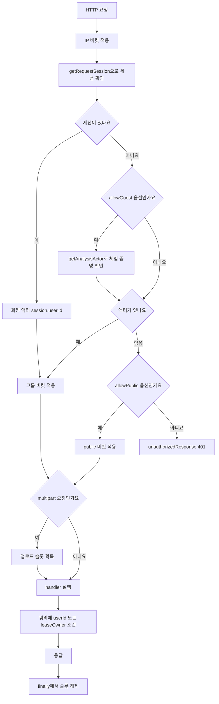
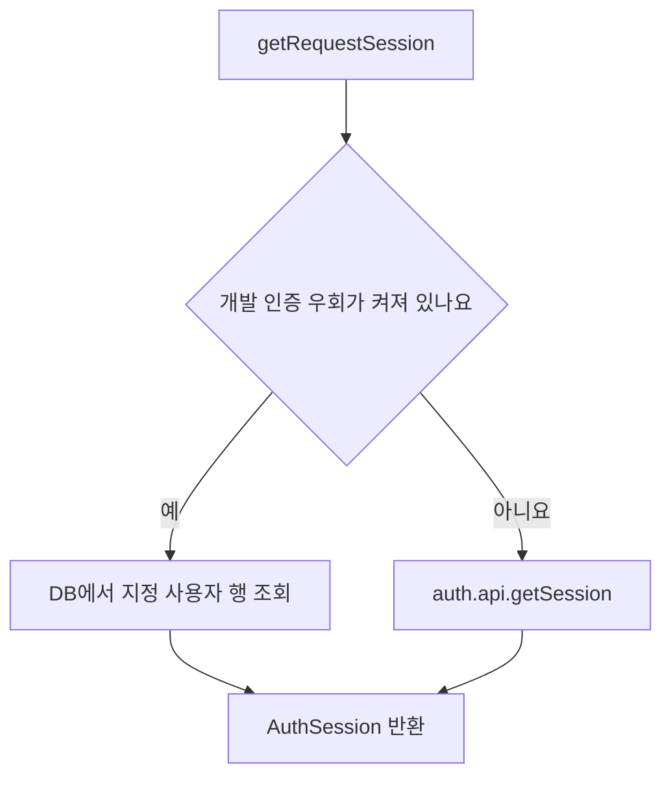

새 route를 추가하거나 조회 범위를 넓힐 때 먼저 정할 것은 "어디까지 통과시킬지"예요. 이 저장소의 증명은 세 가지예요. Better Auth 세션, 관리자 이메일 허용 목록(allowlist), 그리고 브라우저 쿠키로 오는 비회원 체험 증명이에요. 앞의 두 개는 `features/authentication`의 함수가 판정하고, 체험 증명은 `getAnalysisActor`가 판정해요. 어느 증명으로 통과했든 자원 소유권은 마지막에 쿼리 조건이 확인해요. 이 페이지는 세 함수군의 역할을 비교하고, 마지막 절의 체크리스트로 새 route에 적용할 순서를 정리해요.

## admission 래퍼가 증명 범위를 먼저 좁혀요

`withApiAdmission`은 handler를 호출하기 전에 IP 버킷 → 세션 확인 → 액터 결정 → 그룹 버킷 → 업로드 슬롯 순서로 통과시켜요([admission.ts](repo://src/_app/api-routes/admission.ts#L11-L39)). 세션이 있으면 액터는 `session.user.id`이고, 없으면 `allowGuest` 옵션일 때만 `getAnalysisActor(request)`로 체험 증명을 시도해요. 액터도 없고 `allowPublic`도 아니면 handler를 부르지 않고 `unauthorizedResponse()` 401을 반환해요. 그룹 버킷은 액터가 있으면 `user:${userId}:${group}`, 없으면 `public:${ip}:${group}` 키를 쓰고, `Content-Type`이 `multipart/form-data`로 시작하면 업로드 슬롯을 잡아 `finally`에서 해제해요([admission.ts](repo://src/_app/api-routes/admission.ts#L24-L37)).

| 옵션 | 세션이 없을 때 | 액터 | 그룹 버킷 키 |
| --- | --- | --- | --- |
| 없음(기본) | `unauthorizedResponse()` 401 | 세션만 | `user:${userId}:${group}` |
| `allowGuest: true` | `getAnalysisActor`로 체험 증명 시도, 없으면 401 | 세션 또는 체험 | 액터의 `userId` |
| `allowPublic: true` | 액터 없이 통과 | 세션·체험·없음 | 없으면 `public:${ip ?? "untrusted-ingress"}:${group}` |



래퍼는 증명을 확인할 뿐 자원 소유권을 확인하지 않아요. handler에 도달한 요청이 어떤 자원을 만질 수 있는지는 handler와 도메인 함수가 정해요. 그룹별 rate·burst 수치와 오류 봉투 형태는 [HTTP API 표면과 요청 접수 규칙](../architecture/http-api-surface.md)이 소유해요.

## 세션과 체험 증명은 서로 다른 액터를 만들어요

이 저장소에서 "누구인가"를 돌려주는 함수는 다섯 개이고, 반환 타입과 실패 처리가 서로 달라요. 새 route에서 무엇을 쓸지는 아래 표로 정해요.

| 함수 | 보는 증명 | 반환 | 증명이 없을 때 |
| --- | --- | --- | --- |
| `getRequestSession(request?)` | 세션만 | `AuthSession` 또는 `null` | `null` |
| `requireApiSession(request)` | 세션만 | `getRequestSession`과 같아요 | `null`(401은 호출자가 만들어요) |
| `requirePageSession(returnTo)` | 세션만 | 세션, 또는 `redirect()` | `/login?callbackURL=...` |
| `getAnalysisActor(request?)` | 세션, 없으면 체험 쿠키 | `{ userId, guest: false }` 또는 `{ userId, guest: true }` | `null` |
| `getAnalysisResourceActor(request, { jobId \| profileId })` | 위 결과 + 자원 일치 | 같은 모양 | `null` |

`getAnalysisActor`는 세션이 있으면 바로 회원 액터를 돌려주고, 없을 때만 요청 헤더에서 체험 쿠키를 읽어 `getGuestTrial`로 trial을 찾아요. trial이 있고 아직 저장(`claimedAt`)되지 않았으면 그 trial의 `userId`를 체험 액터로 돌려줘요([analysis-actor.ts](repo://src/features/authentication/api/analysis-actor.ts#L7-L13)).

`getAnalysisResourceActor`는 액터가 없거나 이미 체험이면 그대로 돌려줘요. 회원 세션이 있는 경우에는 체험 trial을 한 번 더 읽어서 요청한 `jobId` 또는 `profileId`가 그 trial의 작업과 일치하고 아직 저장 전이면, 회원 액터 대신 체험 액터를 반환해요([analysis-actor.ts](repo://src/features/authentication/api/analysis-actor.ts#L15-L26)). 그래서 로그인한 사용자가 저장하지 않은 자기 체험 결과를 열거나 삭제할 때도 handler는 체험 분기를 타요.

체험 증명만 가진 요청은 `requireApiSession`에서 `null`이고 `requirePageSession`도 통과하지 못해요. [tests/guest-analysis.integration.ts](repo://tests/guest-analysis.integration.ts#L24-L28)가 같은 요청에 대해 `getAnalysisActor`는 체험 액터를, `requireApiSession`은 `null`을 반환하는 것을 확인해요. 그래서 체험을 허용하는 route는 admission의 `allowGuest` 옵션과 handler의 `getAnalysisActor` 호출을 함께 써야 하고, 회원 전용 route는 기본 래퍼가 401로 끊어요.

| 요청 예 | 체험 증명만 있을 때 | 근거 |
| --- | --- | --- |
| `/api/account/tickets` GET | 401 | [tests/guest-analysis.integration.ts](repo://tests/guest-analysis.integration.ts#L24-L28) |
| `/api/mixing-jobs` POST | 401(믹싱은 회원 전용) | [tests/guest-analysis.integration.ts](repo://tests/guest-analysis.integration.ts#L580-L584) |
| `/api/recommendations` GET·POST | 200, 단 그 trial의 프로필만 | [tests/guest-analysis.integration.ts](repo://tests/guest-analysis.integration.ts#L519-L544) |
| 다른 trial의 프로필 조회 | 404 | [tests/guest-analysis.integration.ts](repo://tests/guest-analysis.integration.ts#L545-L553) |
| 증명 없음 | 401, `allowPublic` route는 예외 | [admission.ts](repo://src/_app/api-routes/admission.ts#L21-L22) |

`allowGuest`를 켠 route는 [vocal-profile-detail-route.ts](repo://src/_app/api-routes/vocal-profiles/vocal-profile-detail-route.ts#L124-L128)처럼 메서드마다 옵션을 따로 줄 수 있어요. 읽기와 삭제는 체험을 허용하고 이름 변경은 회원 전용으로 남기는 구성이 실제로 그래요. `allowPublic`은 지금 분석 작업 목록 GET 하나에만 붙어 있어요([vocal-profile-analysis-jobs-route.ts](repo://src/_app/api-routes/vocal-profiles/vocal-profile-analysis-jobs-route.ts#L160-L162)). 그 GET은 증명이 없으면 체험 정책과 빈 작업 목록을 돌려주고, 체험 증명이 있으면 그 trial의 작업만 노출해요([vocal-profile-analysis-jobs-route.ts](repo://src/_app/api-routes/vocal-profiles/vocal-profile-analysis-jobs-route.ts#L75-L87)).

### 액터 판정과 가독성 판정은 시점이 달라요

`getAnalysisActor`는 trial의 `claimedAt`만 보고, 만료(`expiresAt`)는 보지 않아요([analysis-actor.ts](repo://src/features/authentication/api/analysis-actor.ts#L10-L12)). 반면 자원을 실제로 내려주기 전에 부르는 `canReadGuestResource`는 `guestTrialIsReadable`로 `claimedAt`이 없고 `expiresAt`이 지나지 않았을 때만 `true`이고, 요청한 `jobId`·`profileId`가 그 trial의 것인지도 함께 확인해요([trial.ts](repo://src/entities/guest-analysis/api/trial.ts#L45-L56)).

그래서 역할이 나뉘어요. admission은 "이 요청이 체험 신원을 가졌는가"만 판정하고, 만료된 결과를 숨기는 일은 자원 함수가 맡아요. 체험 액터를 받아 자원을 돌려주는 handler는 `canReadGuestResource`를 한 번 더 불러야 하고, 실제로 프로필 상세·오디오·합성 레퍼런스·분석 작업 상세·추천 route가 모두 그렇게 해요([vocal-profile-audio-route.ts](repo://src/_app/api-routes/vocal-profiles/vocal-profile-audio-route.ts#L7-L12)).

체험 token이 회원 계정으로 소유권을 넘기는 시점, 결과 보관 기한, 만료 정리는 [비회원 체험 분석 수명 주기](../workflows/guest-analysis-trial.md)가 소유해요.

## 요청 안에서 세션은 WeakMap으로 메모이제이션돼요

`getRequestSession(request?)`는 `Request` 객체를 키로 쓰는 `WeakMap`에 세션 Promise를 저장해요. 그래서 같은 요청 안에서 여러 번 불러도 세션 조회는 한 번만 일어나요. 인자를 주지 않으면 `next/headers`의 `headers()`를 쓰고, 해석 순서는 개발 인증 우회 세션을 먼저 시도한 뒤 `auth.api.getSession({ headers })`를 부르는 순서예요([session.ts](repo://src/features/authentication/api/session.ts#L8-L25)). admission 래퍼가 같은 `Request`로 세션을 확인해 두므로, handler의 `requireApiSession(request)`는 저장된 결과를 다시 써요.



세션 하나를 해석하는 분기예요. 두 경로 모두 `AuthSession` 또는 `null`을 돌려주니, 그 위 코드는 어느 쪽으로 해석됐는지까지 알 필요가 없어요.

세션을 강제하는 방법은 페이지와 API가 달라요. 페이지는 `requirePageSession(returnTo)`가 세션이 없으면 `returnTo`를 URL 인코딩해 `/login?callbackURL=...`으로 리다이렉트해요. API는 세션을 강제하지 않고 세션 또는 `null`만 돌려주니, handler가 `unauthorizedResponse()`로 401을 만들죠([session.ts](repo://src/features/authentication/api/session.ts#L27-L44)).

```json
{ "error": { "code": "UNAUTHENTICATED", "message": "Google 로그인이 필요해요.", "retryable": false } }
```

이 401 봉투는 [tests/new-user-onboarding.integration.ts](repo://tests/new-user-onboarding.integration.ts#L19-L31)가 실제 handler 응답으로 확인해요.

`requirePageSession`이 페이지마다 `returnTo`를 직접 받는 이유는 리다이렉트 정밀도 때문이에요. 공용 `ProductLayout`은 인증을 강제하지 않아요. 세션이 없으면 `user={null}`인 shell을 그대로 렌더링하고, 세션이 있으면 관리자 여부·온보딩 스냅샷·사용자 정보를 덧붙여요([product-layout.tsx](repo://src/_app/layout/product-layout.tsx#L14-L43)). 그래서 로그인 여부는 각 page가 정하고, 자기 경로를 넘겨 callback URL을 정확히 만들어요. 계정 화면은 `requirePageSession("/account")`을 호출해요([account-page.tsx](repo://src/_pages/account/ui/account-page.tsx#L17-L22)).

체험 열람을 허용하는 page는 순서가 하나 더 있어요. 먼저 `getAnalysisResourceActor(undefined, { profileId })`로 액터를 확인하고, 액터가 없을 때만 `requirePageSession(returnTo)`로 리다이렉트한 뒤 `notFound()`를 태워요([song-detail-page.tsx](repo://src/_pages/song-detail/ui/song-detail-page.tsx#L19-L26), [recommendation-detail-page.tsx](repo://src/_pages/recommendation-detail/ui/recommendation-detail-page.tsx#L19-L25)). `requirePageSession`을 먼저 부르면 체험 사용자가 로그인 화면으로 튕기니 순서를 바꾸지 마세요.

로그인 후 돌아갈 주소는 `safeCallbackURL`이 걸러요. `/`로 시작하고 `//`·`\`를 포함하지 않으며 origin이 로컬 경로로 해석되는 값만 통과하고, 나머지는 `/profile`로 떨어져요([safe-callback-url.ts](repo://src/features/authentication/model/safe-callback-url.ts#L3-L13)). 외부 URL·프로토콜 상대 URL·역슬래시 우회 시도가 모두 기본값으로 접히는지는 [tests/auth-navigation.test.ts](repo://tests/auth-navigation.test.ts#L18-L28)가 검사해요.

## 로그인은 Google OAuth 하나만 열려 있어요

Better Auth 설정은 Google 소셜 로그인 하나만 열어 두고 이메일·비밀번호 로그인을 꺼 둬요. 데이터베이스는 Prisma adapter(PostgreSQL)를 쓰고, `appName`은 `Copysinger`예요([auth.ts](repo://src/features/authentication/api/auth.ts#L11-L41)).

| 설정 | 값 | 의미 |
| --- | --- | --- |
| `baseURL` | `BETTER_AUTH_URL`을 읽고 없으면 `http://localhost:3000` | 로컬 기본값이 있어요 |
| `secret` | `resolveAuthSecret(process.env)` | 개발·테스트 밖에서는 `BETTER_AUTH_SECRET`이 없으면 예외를 던져요 |
| `database` | `prismaAdapter(prisma, { provider: "postgresql" })` | 세션·계정 행이 PostgreSQL에 저장돼요 |
| `emailAndPassword` | `{ enabled: false }` | 비밀번호 로그인 경로가 없어요 |
| `socialProviders.google` | scope `openid`, `email`, `profile` | 인증 수단은 Google 계정뿐이에요 |

secret 해석 규칙은 fail-closed예요. `BETTER_AUTH_SECRET`이 있으면 trim한 값을 쓰고, 없으면 `NODE_ENV`가 `development`·`test`일 때만 개발용 상수를 반환하며, 그 밖의 환경에서는 오류를 던져요([auth-secret-policy.ts](repo://src/features/authentication/model/auth-secret-policy.ts#L8-L13)). [tests/auth-navigation.test.ts](repo://tests/auth-navigation.test.ts#L9-L16)가 이 세 갈래를 모두 검사해요.

설정이 모두 채워졌는지는 `googleAuthConfigured()`가 판단해요. `BETTER_AUTH_SECRET`, `BETTER_AUTH_URL`, `GOOGLE_CLIENT_ID`, `GOOGLE_CLIENT_SECRET` 네 값이 모두 있어야 `true`고([auth.ts](repo://src/features/authentication/api/auth.ts#L43-L49)), 값이 하나라도 비면 로그인 화면의 Google 버튼이 비활성화되고 안내 문구가 떠요([google-sign-in.tsx](repo://src/features/authentication/ui/google-sign-in.tsx#L22-L35)).

새 사용자가 만들어질 때는 `databaseHooks.user.create.after`가 `ensureSignupTicketGrants(user.id)`를 호출해요([auth.ts](repo://src/features/authentication/api/auth.ts#L32-L40)). 가입 지급의 멱등 규칙은 [티켓 원장과 멱등성](../concepts/ticket-ledger.md)이 소유해요.

Better Auth의 HTTP endpoint는 `app/api/auth/[...all]/route.ts`가 `src/_app/api-routes/auth/index.server.ts`를 re-export하는 구조예요. 그 handler는 `toNextJsHandler(auth)`를 `withAuthAdmission`으로 감싼 형태라, 인증 흐름 자체에는 세션 검사를 걸지 않고 인증 전용 버킷만 적용해요([auth-route.ts](repo://src/_app/api-routes/auth/auth-route.ts#L1-L7)).

## 개발 인증 우회는 development와 test에서만 켜져요

개발 인증 우회는 세 조건을 모두 만족할 때만 활성화돼요. 하나라도 어긋나면 `developmentAuthBypassUserId`가 `null`을 돌려주고 일반 Better Auth 세션 경로를 그대로 써요([dev-bypass-policy.ts](repo://src/features/authentication/model/dev-bypass-policy.ts#L7-L12)).

| 조건 | 통과 값 | 어긋날 때 |
| --- | --- | --- |
| `NODE_ENV` | `development` 또는 `test` | `production`·미설정이면 우회 비활성 |
| `DEV_AUTH_BYPASS_ENABLED` | trim·소문자 변환 후 `"true"` | `"false"`·미설정이면 우회 비활성 |
| `DEV_AUTH_BYPASS_USER_ID` | trim 후 비어 있지 않은 값 | 공백뿐이면 우회 비활성 |

우회 세션은 지정한 사용자 행을 실제로 조회해서 만들어요. 그 id의 사용자가 데이터베이스에 없으면 조용히 넘어가지 않고 오류를 던져요. 만들어진 세션의 `token`은 `dev-auth-bypass`이고 만료는 생성 시점에서 24시간 뒤예요([dev-bypass.ts](repo://src/features/authentication/api/dev-bypass.ts#L9-L31)).

우회 세션인지 구분하는 함수는 `isDevelopmentAuthBypassSession`이에요. 이 값이 `true`면 계정 메뉴에 로그아웃 대신 `개발 인증 우회 사용 중`이 표시되고([user-menu.tsx](repo://src/features/authentication/ui/user-menu.tsx#L133-L141)), 레이아웃은 온보딩 스냅샷 조회를 건너뛰어요([product-layout.tsx](repo://src/_app/layout/product-layout.tsx#L20-L28)).

정책 자체는 순수 함수라 테스트가 직접 환경 값을 바꿔 확인해요. [tests/dev-auth-bypass.integration.ts](repo://tests/dev-auth-bypass.integration.ts#L7-L26)가 개발·테스트 밖에서 우회가 꺼지는 것을, 같은 파일의 두 번째 테스트가 기존 사용자만 세션으로 해석되는 것을 확인해요([tests/dev-auth-bypass.integration.ts](repo://tests/dev-auth-bypass.integration.ts#L28-L50)). 미인증 401을 확인하는 테스트는 `DEV_AUTH_BYPASS_ENABLED`를 `"false"`로 되돌린 뒤 요청을 보내요([tests/new-user-onboarding.integration.ts](repo://tests/new-user-onboarding.integration.ts#L19-L31)).

## 관리자 경계는 이메일 allowlist로 판정해요

관리자 여부는 역할 테이블이 아니라 이메일 allowlist로 판정해요. `adminEmails()`가 `ADMIN_EMAILS`를 쉼표로 나눠 trim·소문자로 정규화하고 빈 값을 버린 뒤 `Set`을 만들고, `isAdminEmail`은 입력 이메일을 같은 방식으로 정규화해 포함 여부만 봐요([admin-policy.ts](repo://src/features/authentication/model/admin-policy.ts#L3-L14)). [tests/admin-operations.integration.ts](repo://tests/admin-operations.integration.ts#L12-L38)가 대문자·공백이 섞인 allowlist 항목을 실제로 통과시키는지 확인해요.

같은 판정 함수를 쓰지만 페이지와 API의 실패 응답이 달라요. 이 차이가 관리자 화면의 존재 자체를 숨기는 장치예요.

| 진입점 | 세션 없음 | 관리자 아님 | 근거 |
| --- | --- | --- | --- |
| `requireAdminPage()` | `notFound()` | `notFound()` | [admin.ts](repo://src/features/authentication/api/admin.ts#L8-L15) |
| `requireAdminApi(request)` | 401 `UNAUTHENTICATED` | 403 `FORBIDDEN` | [admin.ts](repo://src/features/authentication/api/admin.ts#L17-L27) |

`requireAdminApi`는 성공 시 `{ response: null, session }`을 돌려주니, handler는 `if (access.response) return access.response;`로 검사하고 통과한 세션을 그대로 이어서 써요. 관리자 catalog handler와 개요 handler가 모두 이 형태예요([catalog-route.ts](repo://src/_app/api-routes/admin/catalog/catalog-route.ts#L13-L23), [overview-route.ts](repo://src/_app/api-routes/admin/overview-route.ts#L5-L9)).

관리자 페이지는 데이터 조회 전에 `requireAdminPage()`를 호출해요. 그래서 권한 없는 세션은 관리자 화면을 404로 보게 돼요([admin-page.tsx](repo://src/_pages/admin/ui/admin-page.tsx#L173-L180)). 계정 메뉴의 관리 링크는 `isAdminEmail` 결과로 렌더 여부만 바뀌는 편의 장치예요([user-menu.tsx](repo://src/features/authentication/ui/user-menu.tsx#L126-L130)). 실제 차단은 항상 서버의 allowlist 검사가 담당하니, UI 조건을 인가 근거로 삼지 마세요.

## 자원 소유권은 쿼리 조건과 lease로 검증해요

소유권 검증은 "이 사용자가 이 자원을 요청할 수 있는가"를 쿼리 조건으로 표현하는 방식이에요. handler가 받은 액터의 `userId`를 도메인 함수의 인자로 넘겨서, 조건이 handler 바깥으로 새지 않게 해요.

| 패턴 | 동작 | 실제 예 |
| --- | --- | --- |
| 단건 조회에 `userId` 조건 | `findFirst({ where: { id, userId } })`, 결과가 없으면 404 | [getMixingJobForUser](repo://src/entities/mixing-job/api/history.ts#L152-L155), [mixing-job-detail-route.ts](repo://src/_app/api-routes/mixing-jobs/mixing-job-detail-route.ts#L6-L14) |
| 목록 조회를 액터 사용자로 고정 | `userId`를 where에 넣어 다른 사용자의 행이 섞이지 않아요 | [getMixingHistory](repo://src/entities/mixing-job/api/history.ts#L129-L150), [notifications-route.ts](repo://src/_app/api-routes/notifications/notifications-route.ts#L5-L15) |
| 참조 자산의 소유자·종류·상태 재확인 | 자산의 `userId`, `kind`, `status`를 다시 비교해 어긋나면 `null` | [getVocalProfileReference](repo://src/entities/vocal-profile/api/history.ts#L103-L120) |
| 트랜잭션 안에서 행 잠금 | `SELECT ... WHERE id = ... AND "userId" = ... FOR UPDATE` | [vocal-profile-detail-route.ts](repo://src/_app/api-routes/vocal-profiles/vocal-profile-detail-route.ts#L83-L106), [deletion.ts](repo://src/entities/mixing-job/api/deletion.ts#L9-L39) |
| 소유권 인자를 도메인 함수의 필수 인자로 넘기기 | handler가 `userId`를 인자로 넘겨 조건이 함수 안에서 만들어져요 | [getVocalProfileDetail](repo://src/entities/vocal-profile/api/history.ts#L87-L101), [getMixingJobForUser](repo://src/entities/mixing-job/api/history.ts#L152-L155) |
| 워커의 lease owner | `leaseOwner`와 `leaseExpiresAt`이 맞아야 진행하고, 아니면 `LeaseLostError` | [lease.ts](repo://src/shared/lib/runtime/lease.ts#L22-L36), [mixing worker.ts](repo://src/_app/background-jobs/mixing/worker.ts#L138-L154) |

남의 자원에는 403이 아니라 404를 돌려줘요. 믹싱 작업 상세는 소유자가 다르면 `MIXING_NOT_FOUND` 404를 반환하고, 잘못된 id 형식도 같은 응답으로 처리해 자원 존재 여부를 노출하지 않아요([mixing-job-detail-route.ts](repo://src/_app/api-routes/mixing-jobs/mixing-job-detail-route.ts#L9-L13)). [tests/mixing-queue.integration.ts](repo://tests/mixing-queue.integration.ts#L565-L568)가 다른 사용자 id로 삭제를 시도했을 때 `MIXING_NOT_FOUND` 404가 나오는 것을 확인해요.

`getRecommendationResult`처럼 `userId`가 선택 인자인 함수는 호출자가 넘기지 않으면 소유권 조건이 빠져요. handler가 액터의 `userId`를 항상 넘기는 이유가 여기 있고, 추천 handler도 그렇게 호출해요([recommendations-route.ts](repo://src/_app/api-routes/recommendations/recommendations-route.ts#L42-L47)). 클라이언트가 보낸 본문의 사용자 id를 소유권 근거로 쓰면 안 되는 대표적인 예가 티켓 조정이에요. 관리자 티켓 조정은 `actorUserId`를 요청 본문이 아니라 `access.session.user.id`로 채워요([ticket-adjustments-route.ts](repo://src/_app/api-routes/admin/ticket-adjustments-route.ts#L7-L25)).

사용자별 소유권 범위는 [tests/auth-ownership.integration.ts](repo://tests/auth-ownership.integration.ts#L7-L59)가 실제 데이터베이스로 확인해요. 같은 프로필 행이 소유자 조건에서는 1건, 다른 사용자 조건에서는 0건으로 조회되는지, 그리고 Google 연결 요약이 사용자별로 갈리는지를 검사해요.

### 프로필 route는 메서드마다 통과 증명이 달라요

프로필 상세 route 하나에도 세 가지 경계가 겹쳐 있어요. 증명 종류, `sourceType` 조건, 그리고 삭제 경합 처리예요.

| 메서드 | 액터 함수 | 체험 액터일 때 | 회원 액터일 때 |
| --- | --- | --- | --- |
| GET | `getAnalysisResourceActor(..., { profileId })` | `canReadGuestResource`를 통과해야 조회, 아니면 404 | `userId` 조건 조회, `sourceType`이 `USER`가 아니면 404 |
| PATCH | `requireApiSession` | 401(이름 변경은 회원 전용) | `userId` + `sourceType: "USER"` 조건, 없으면 404 |
| DELETE | `getAnalysisResourceActor(..., { profileId })` | `deleteGuestResult`로 체험 결과를 정리하고 202 | 트랜잭션에서 행을 잠그고 삭제, 믹싱 작업이 있으면 409 |

```ts
export const GET = withApiAdmission(handleGET, { allowGuest: true });
export const PATCH = withApiAdmission(handlePATCH);
export const DELETE = withApiAdmission(handleDELETE, { allowGuest: true });
```

세 메서드의 옵션 차이가 곧 권한 차이예요([vocal-profile-detail-route.ts](repo://src/_app/api-routes/vocal-profiles/vocal-profile-detail-route.ts#L124-L128)). PATCH는 `requireApiSession`만 쓰므로 체험 trial의 프로필은 이름을 바꿀 수 없고, 회원 세션으로 호출해도 조회 조건이 `session.user.id`라 체험 소유 프로필은 404가 돼요([vocal-profile-detail-route.ts](repo://src/_app/api-routes/vocal-profiles/vocal-profile-detail-route.ts#L39-L59)).

`sourceType` 조건은 자원 종류를 사용자 프로필로 고정해요. `VocalProfileSourceType`은 `USER`와 `SONG` 두 값이 있고([schema.prisma](repo://prisma/schema.prisma#L24-L27)), 사용자 프로필 route는 `USER`가 아닌 행을 404로 숨겨요([vocal-profile-detail-route.ts](repo://src/_app/api-routes/vocal-profiles/vocal-profile-detail-route.ts#L32-L35)). 같은 조건이 PATCH와 DELETE의 조회에도 반복돼요.

DELETE는 두 경로의 구현이 완전히 달라요. 체험 분기는 `deleteGuestResult(actor.userId, id)`에 위임하고 성공하면 `202`와 `mediaCleanupPending: true`를 고정으로 반환해요([vocal-profile-detail-route.ts](repo://src/_app/api-routes/vocal-profiles/vocal-profile-detail-route.ts#L74-L82)). `deleteGuestResult`는 트랜잭션 안에서 `GuestAnalysisTrial` 행을 `userId`로 잠그고, trial이 읽기 가능하며 `trial.job?.vocalProfileId`가 요청한 id와 같을 때만 정리해요. 어긋나면 `GuestAnalysisError("GUEST_RESULT_NOT_FOUND", 404)`를 던지고 route가 404로 바꿔요([lifecycle.ts](repo://src/entities/guest-analysis/api/lifecycle.ts#L134-L142)).

회원 분기는 `SELECT ... FOR UPDATE`로 `VocalProfile` 행을 먼저 잠근 뒤 `userId`와 `sourceType: "USER"` 조건으로 다시 읽어요. 연결된 믹싱 작업이 있으면 `PROFILE_IN_USE` 409로 멈추고, 없으면 프로필과 녹음을 지운 뒤 미디어 자산 삭제를 예약해요. 응답 상태는 실제 정리 진행에 따라 200 또는 202로 갈라져요([vocal-profile-detail-route.ts](repo://src/_app/api-routes/vocal-profiles/vocal-profile-detail-route.ts#L83-L121)). 같은 잠금-재확인 패턴이 믹싱 작업 삭제에도 있고, 그쪽은 잠금 뒤 상태·환불·결과 자산을 다시 확인해요([deletion.ts](repo://src/entities/mixing-job/api/deletion.ts#L9-L39)). 잠금이 실제로 원본 파일과 티켓을 지키는지는 [tests/profile-deletion-race.integration.ts](repo://tests/profile-deletion-race.integration.ts#L115-L153)가 삭제와 믹싱 접수를 동시에 던져 확인해요.

## 새 API를 추가할 때 확인할 체크리스트

1. handler를 `withApiAdmission`으로 감싸세요. 세션 없는 요청은 handler 본문에 닿기 전에 401로 끊기고, 그룹 버킷과 업로드 슬롯이 자동으로 붙어요([admission.ts](repo://src/_app/api-routes/admission.ts#L11-L39)).
2. 체험 열람을 허용할 메서드에만 `allowGuest: true`를 붙이고, handler에서는 `getAnalysisActor(request)`로 액터를 받아 `actor.guest`로 분기하세요. 증명 없는 공개 조회는 `allowPublic: true`가 필요하고, 지금은 분석 작업 목록 GET만 그렇게 해요([vocal-profile-analysis-jobs-route.ts](repo://src/_app/api-routes/vocal-profiles/vocal-profile-analysis-jobs-route.ts#L160-L162)).
3. 회원 전용 handler는 `requireApiSession(request)`를 쓰고 `null`이면 `unauthorizedResponse()`를 반환하세요. 체험 증명만으로는 이 함수가 통과하지 않으니, 체험을 허용하려면 2번의 액터 함수가 필요해요.
4. 체험 액터가 자원을 요청하면 `canReadGuestResource`로 만료·저장 여부·자원 일치를 다시 검사하세요. admission은 만료를 보지 않아요([trial.ts](repo://src/entities/guest-analysis/api/trial.ts#L45-L56)).
5. 조회·수정·삭제 쿼리에 `userId` 조건을 넣고, 없거나 남의 자원이면 같은 404로 답하세요. 사용자 프로필 route라면 `sourceType` 조건도 함께 넣으세요. 삭제처럼 경합이 있는 경로는 트랜잭션 안에서 `FOR UPDATE`로 행을 잠그세요.
6. 관리자 전용이면 `requireAdminApi`를 쓰고 `access.response`가 있으면 그대로 반환하세요. 관리자 페이지는 `requireAdminPage`로 `notFound()`를 태워 화면 존재를 숨기세요.
7. 새 오류 봉투를 만들지 말고 같은 그룹의 기존 형태를 따르세요. 누가 요청했는지를 나타내는 `actorUserId` 같은 값은 요청 본문이 아니라 세션에서 채우세요.
8. 사용자 파라미터를 도메인 함수로 넘길 때 선택 인자로 두지 마세요. 인자를 빼면 소유권 조건이 조용히 사라져요.
9. 워커가 처리하는 경로라면 조회·갱신 쿼리에 `leaseOwner` 조건을 넣으세요. 점유·heartbeat·재시도 규칙은 [Job 큐와 lease 복구 계약](../operations/job-processing.md)이 소유해요.

| 확인 대상 | 명령 또는 문서 |
| --- | --- |
| 우회 정책과 사용자별 소유권 범위 | `pnpm run test:auth:db`([package.json](repo://package.json#L64), [tests/auth-ownership.integration.ts](repo://tests/auth-ownership.integration.ts#L7-L59), [tests/dev-auth-bypass.integration.ts](repo://tests/dev-auth-bypass.integration.ts#L7-L50)) |
| 미인증 401 봉투와 세션 강제 | `pnpm run test:onboarding`([package.json](repo://package.json#L65), [tests/new-user-onboarding.integration.ts](repo://tests/new-user-onboarding.integration.ts#L19-L31)) |
| secret 정책, callback URL, 로그인 화면, 레이아웃 경계 | `pnpm run test:auth-navigation`([tests/auth-navigation.test.ts](repo://tests/auth-navigation.test.ts#L9-L28)) |
| 관리자 조회와 티켓 조정 경계 | `pnpm run test:admin`([tests/admin-operations.integration.ts](repo://tests/admin-operations.integration.ts#L7-L59)) |
| 체험 액터와 회원 전용 경계 | `pnpm run test:guest-analysis`([package.json](repo://package.json#L75), [tests/guest-analysis.integration.ts](repo://tests/guest-analysis.integration.ts#L24-L28)) |
| 프로필 삭제와 믹싱 접수 경합 | `pnpm run test:readiness`([package.json](repo://package.json#L71), [tests/profile-deletion-race.integration.ts](repo://tests/profile-deletion-race.integration.ts#L115-L153)) |
| 환경 변수 이름·필수 조건 | [환경 변수와 런타임 한도](../operations/configuration.md) |
| 계층 경계와 새 코드 위치 | [시스템 지도와 경계](../architecture/system-map.md) |
| 세션 이후 도메인 처리 절차 | [AI 믹싱 작업 흐름](../workflows/ai-mixing.md) |
