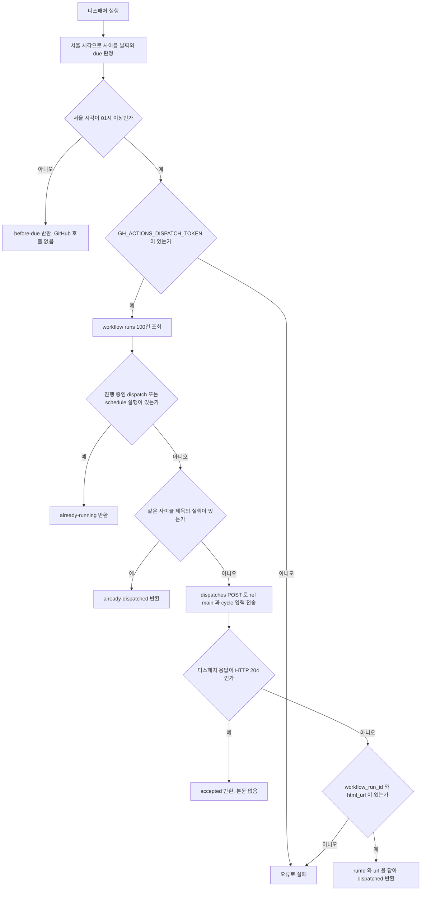
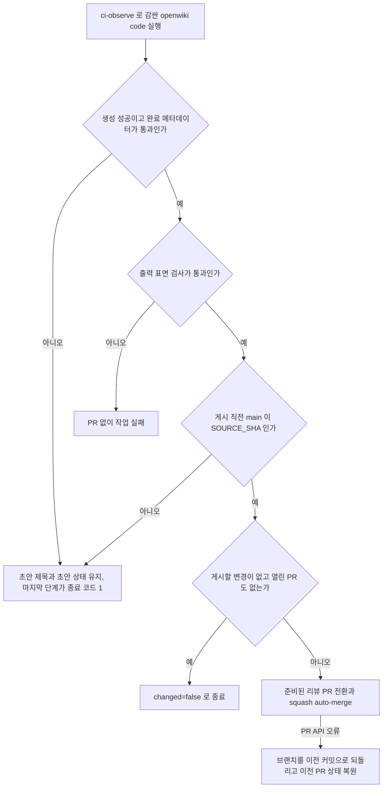

`openwiki/**` 문서를 만드는 자동화를 바꾸려면 어느 파일이 무엇을 결정하는지 먼저 알아야 해요. 이 페이지에서는 로컬 동기화 명령과 CI 생성 경로가 어떻게 갈라지는지, Coolify가 스케줄하는 디스패처가 실행 시점과 중복을 어떻게 판정하는지, 그리고 CI 실행이 어떤 게이트를 지나야 준비된 리뷰 PR이 되는지 순서대로 확인해요.

생성 페이지는 손으로 고치지 않아요. 근거가 되는 source나 curated docs를 고친 뒤 동기화를 다시 돌리는 것이 이 저장소의 규칙이에요([README.md](repo://README.md#L277-L284), [docs/README.md](repo://docs/README.md#L23-L37)).

## 정본은 docs, 파생은 openwiki

`openwiki/`는 tracked 코드·스키마·설정·테스트에서 파생한 온보딩 evidence이고 정본이 아니에요. 어떤 질문에 어떤 문서를 기준으로 삼을지는 저장소가 정해 두었어요([docs/README.md](repo://docs/README.md#L27-L33), [README.md](repo://README.md#L265-L273)).

| 알아야 할 정보 | 기준 | `openwiki/`의 역할 |
| --- | --- | --- |
| 장기 제품 요구사항 | `docs/prd/` | 요구사항 위치와 관련 코드 탐색 보조 |
| 현재 변경 범위·설계·태스크·결정 | 활성 Feature SDD의 `spec.md`, `plan.md`, `tasks.md`, `decisions.md` | Feature 이력과 구현 위치 탐색 보조 |
| 프로젝트 전체 설명과 정책 | 사람이 관리하는 curated docs | 관련 설명을 연결하되 대체하지 않음 |
| 실행 가능한 런타임 사실 | tracked 코드·스키마·설정 | 구조와 흐름 요약, 원본 검증 경로 제공 |

`docs/features/`는 생성 입력에서 제외되어 있어서 이 페이지도 Feature 문서의 내용 자체는 확인하지 못했어요. 그래서 결정의 이유를 찾을 때는 `git log`·`git blame`으로 `F###`를 찾아 해당 Feature의 `decisions.md`로 이동하고, OpenWiki에는 현재 구조 설명만 둬요([README.md](repo://README.md#L286-L293)).

## 로컬 동기화와 CI 생성 경로는 진입점이 달라요

로컬에서 문서를 갱신하고 결과를 확인할 때 쓰는 명령은 두 개예요. `<feature-ref>`와 `--component` 값은 실행하는 사람이 채워야 하는 입력이에요([README.md](repo://README.md#L277-L282)).

```bash
npx lee-spec-kit knowledge sync <feature-ref> --component <component> --json

# 생성 결과를 브라우저에서 읽기 전용으로 확인
openwiki visualize ./openwiki
```

이 동기화는 활성 Feature workflow에서 태스크 checkpoint 이후 Feature review 전에 필수예요([docs/README.md](repo://docs/README.md#L35)). 설명이 잘못됐으면 source 또는 curated docs를 고친 뒤 다시 동기화하고, 생성된 `openwiki/**` 페이지는 직접 수정하지 않아요([README.md](repo://README.md#L284)).

CI 워크플로는 이 `knowledge sync` 명령을 부르지 않아요. 워크플로가 Node.js 22를 준비하고([.github/workflows/lee-spec-kit-knowledge.yml](repo://.github/workflows/lee-spec-kit-knowledge.yml#L33-L35)) `openwiki@0.7.2`와 `lee-spec-kit@0.9.23`를 전역 설치한 뒤([.github/workflows/lee-spec-kit-knowledge.yml](repo://.github/workflows/lee-spec-kit-knowledge.yml#L42-L44)), OpenWiki CLI를 직접 실행해요. 그래서 CI 경로에는 Feature 참조와 컴포넌트 입력이 없고, 체크포인트 브랜치에 남은 이전 결과가 `--update` 입력이 돼요.

| 항목 | 로컬 동기화 | CI 생성 |
| --- | --- | --- |
| 진입 명령 | `npx lee-spec-kit knowledge sync <feature-ref> --component <component> --json` | `openwiki code --update --print --language ko`를 `ci-observe.cjs run`으로 감싼 실행 |
| 도구 설치 | `npx`가 `lee-spec-kit`을 받아 실행 | `npm install --global openwiki@0.7.2 lee-spec-kit@0.9.23` |
| 생성 입력 | 활성 Feature 참조와 컴포넌트 | `lee-spec-kit/knowledge-main` 브랜치에 남은 `openwiki/` |
| 결과 확인 | `openwiki visualize ./openwiki`로 읽기 전용 확인 | 게시 게이트가 읽는 `openwiki/.last-update.json`과 업로드되는 관측 산출물 |

CI 쪽은 설치한 `lee-spec-kit`에 들어 있는 `lee-spec-kit-technical-writing` skill을 `OPENWIKI_CONFIG_DIR` 아래 `skills/`로 복사한 뒤 생성 단계를 돌려요([.github/workflows/lee-spec-kit-knowledge.yml](repo://.github/workflows/lee-spec-kit-knowledge.yml#L56-L62)). 이 준비 순서와 각 게이트의 조건은 아래 워크플로 절에서 이어서 확인하세요.

## 생성 입력에서 빠지는 경로

생성 범위는 [.openwikiignore](repo://.openwikiignore#L1-L25)가 정해요. 아래 표는 그 파일이 제외하는 항목을 묶은 것이고, 값을 옮겨 적지 않기 위해 패턴만 정리했어요.

| 제외 항목 | 무엇을 막는가 |
| --- | --- |
| `.lee-spec-kit/openwiki-run.json` | 실행 중 상태 파일이 생성 입력에 섞이는 것 |
| `.env`, `.env.*` | 환경 변수 값 |
| `**/*.pem`, `**/*.key`, `**/*.p12`, `**/*.pfx`, `**/id_rsa`, `**/id_ed25519` | 키·인증서 파일 |
| `**/.aws/`, `**/.ssh/`, `**/credentials/`, `**/.credentials/`, `**/credentials*.json`, `**/secrets/`, `**/.secrets/`, `**/service-account*.json` | 자격 증명 디렉터리와 파일 |
| `docs/features/` | Feature SDD 문서 전체 |
| `/AGENTS.md`, `/CLAUDE.md` | Knowledge source로 쓰지 않는 에이전트 지침 파일 |

두 블록으로 나뉘어 있어요. `docs/features/`까지가 첫 번째 블록(`openwiki-ignore`)이고, `/AGENTS.md`와 `/CLAUDE.md`는 두 번째 블록(`knowledge-source-ignore`)에 들어 있어요. 그래서 이 페이지는 `docs/features/` 내용을 근거로 삼지 않고, `AGENTS.md`·`CLAUDE.md`는 워크플로의 출력 표면 검사에서만 관리 블록 단위로 다뤄요.

로컬 동기화 설정은 tracked 파일인 [.lee-spec-kit/openwiki-sync.json](repo://.lee-spec-kit/openwiki-sync.json#L1-L21)에 남아 있어요.

| 필드 | 값 또는 역할 |
| --- | --- |
| `schemaVersion` | `3` |
| `triggerFeatureRef`, `triggerComponent` | 이 동기화를 유발한 Feature 참조와 컴포넌트 |
| `language` | `ko` |
| `sourceHead`, `baseHead`, `baseRef` | 기준 revision과 `refs/heads/main` |
| `sourceFingerprint`, `outputHash` | 입력 지문과 출력 해시 |
| `openwikiVersion`, `okfVersion` | `0.5.2`, `0.2` |
| `verifiedAt` | 검증 시각 |
| `writingPolicy` | 적용된 기술 문서 작성 adapter와 skill 식별자·해시 |

이 파일이 기록한 `openwikiVersion`은 `0.5.2`인데 CI 워크플로는 `openwiki@0.7.2`를 설치해요. 그래서 CI 실행이 어떤 버전으로 생성했는지는 이 파일이 아니라 워크플로의 설치 단계와 그 실행이 남긴 `openwiki/.last-update.json`으로 확인하세요([.lee-spec-kit/openwiki-sync.json](repo://.lee-spec-kit/openwiki-sync.json#L10-L10), [.github/workflows/lee-spec-kit-knowledge.yml](repo://.github/workflows/lee-spec-kit-knowledge.yml#L42-L44)).

## 디스패처가 실행 시점과 중복을 판정해요

워크플로는 스스로 돌지 않아요. Coolify가 스케줄하는 작은 Node 컨테이너가 GitHub Actions API로 실행을 요청하고, 그 코드가 [dispatch.mjs](repo://ops/knowledge-dispatcher/dispatch.mjs#L30-L80)예요. 컨테이너 이미지는 `node:22-alpine`에 이 파일 하나를 복사하고 8080 포트를 노출해요([Dockerfile](repo://ops/knowledge-dispatcher/Dockerfile#L1-L6)). 스케줄링 주체가 Coolify라는 책임 구분은 워크플로 헤더에도 적혀 있고([.github/workflows/lee-spec-kit-knowledge.yml](repo://.github/workflows/lee-spec-kit-knowledge.yml#L1-L2)), 디렉터리 책임 구분은 [시스템 지도와 경계](../architecture/system-map.md)가 소유하니 여기서는 판정 규칙만 다뤄요.

사이클 날짜와 실행 시점은 서울 시간대(`Asia/Seoul`)로 계산해요. 사이클은 `YYYY-MM-DD` 형식이고, 그 날 서울 시각 01시부터 그 사이클이 due가 돼요. 판정은 시(hour) 값을 1과 비교하는 `Number(parts.hour) >= 1` 한 줄이라 분 단위는 보지 않아요([dispatch.mjs](repo://ops/knowledge-dispatcher/dispatch.mjs#L10-L28)).



서울 시간 기준 사이클 판정과 디스패치 분기를 정리한 흐름이에요.

분기마다 돌려주는 값이 달라서, 호출자는 GitHub을 실제로 호출했는지 구분할 수 있어요.

| 결과 | 조건 | 돌려주는 값 |
| --- | --- | --- |
| `before-due` | 서울 시각이 그 사이클의 01시 이전 | `cycle`만 있고 GitHub 호출은 없어요 |
| `already-running` | 최근 100개 실행 중 `workflow_dispatch` 또는 `schedule` 이벤트의 `status`가 `completed`가 아닌 실행이 있어요 | `cycle` |
| `already-dispatched` | 실행 제목이 `OpenWiki Knowledge <cycle>`인 실행이 있어요 | `cycle` |
| `accepted` | 디스패치 응답이 HTTP 204라 본문이 없어요 | `cycle` |
| `dispatched` | 디스패치 응답에 실행 식별자가 들어 있어요 | `cycle`, `runId`, `url` |

`accepted`는 실패가 아니라 성공이에요. GitHub이 실행 ID 없이 204로 응답하면 디스패처는 본문을 읽지 않고 그대로 `accepted`를 돌려주고([dispatch.mjs](repo://ops/knowledge-dispatcher/dispatch.mjs#L55), [dispatch.mjs](repo://ops/knowledge-dispatcher/dispatch.mjs#L75)), 본문이 있으면 `workflow_run_id`와 `html_url`이 모두 있어야 `dispatched`가 돼요([dispatch.mjs](repo://ops/knowledge-dispatcher/dispatch.mjs#L76-L79)).

`already-dispatched`가 보는 실행 제목은 워크플로의 `run-name` 규칙과 맞물려요. 워크플로는 실행 이름을 `OpenWiki Knowledge` 뒤에 `cycle` 입력이나 이벤트 이름을 붙여 만들고([.github/workflows/lee-spec-kit-knowledge.yml](repo://.github/workflows/lee-spec-kit-knowledge.yml#L549-L549)), 디스패처는 같은 형식의 제목을 찾아 같은 사이클을 두 번 요청하지 않아요([dispatch.mjs](repo://ops/knowledge-dispatcher/dispatch.mjs#L67-L69)).

실패는 조용히 넘어가지 않아요. 토큰 환경 변수 `GH_ACTIONS_DISPATCH_TOKEN`이 없으면 그 자리에서 오류를 던지고([dispatch.mjs](repo://ops/knowledge-dispatcher/dispatch.mjs#L33)), GitHub 응답이 실패하면 메서드와 요청 경로, HTTP 상태, 응답 본문의 `message` 일부를 담은 오류를 던져요. 요청 자체에는 15초 타임아웃이 걸려 있어요([dispatch.mjs](repo://ops/knowledge-dispatcher/dispatch.mjs#L43-L54)). 실행 목록 응답이 배열이 아니거나([dispatch.mjs](repo://ops/knowledge-dispatcher/dispatch.mjs#L58-L59)), 디스패치 응답에 `workflow_run_id`나 `html_url`이 없으면([dispatch.mjs](repo://ops/knowledge-dispatcher/dispatch.mjs#L76-L79)) 그 자리에서 오류를 던져 0이 아닌 종료 코드로 드러나요. 토큰 값은 이 문서를 포함해 어디에도 옮겨 적지 않아요.

컨테이너는 인자 없이 시작하면 디스패치를 시도하지 않고 0.0.0.0의 8080 포트에서 `ok`를 돌려주는 응답 서버만 띄워요. `--dispatch` 인자를 주면 그때 디스패치를 실행하고, 실패하면 `Knowledge dispatch failed: ...` 메시지를 표준 오류로 내보내며 종료 코드를 1로 세워요([dispatch.mjs](repo://ops/knowledge-dispatcher/dispatch.mjs#L82-L98)). 그래서 상태 확인과 실제 실행이 같은 이미지에서 분리돼요.

이 동작은 [tests/knowledge-dispatcher.test.mjs](repo://tests/knowledge-dispatcher.test.mjs#L8-L104)가 고정해요. 01시 경계와 `before-due` 반환을 확인하고([tests/knowledge-dispatcher.test.mjs](repo://tests/knowledge-dispatcher.test.mjs#L8-L21)), `ref: "main"`과 `inputs.cycle`을 담은 요청을 실행 목록 조회 뒤 한 번만 보내는지([tests/knowledge-dispatcher.test.mjs](repo://tests/knowledge-dispatcher.test.mjs#L23-L48)), 같은 사이클 제목이나 진행 중 실행이 있으면 디스패치하지 않는지([tests/knowledge-dispatcher.test.mjs](repo://tests/knowledge-dispatcher.test.mjs#L50-L67)), HTTP 204를 `accepted`로 처리하는지([tests/knowledge-dispatcher.test.mjs](repo://tests/knowledge-dispatcher.test.mjs#L69-L89)), HTTP 503을 가시적 실패로 드러내는지([tests/knowledge-dispatcher.test.mjs](repo://tests/knowledge-dispatcher.test.mjs#L91-L104))를 각각 확인해요.

이 테스트는 [package.json](repo://package.json#L58-L58)의 `test:openwiki` script가 실행해요. script 본문이 `node --test tests/knowledge-dispatcher.test.mjs`라서, 디스패처를 고쳤다면 `pnpm run test:openwiki`로 이 파일만 따로 돌릴 수 있어요.

## 워크플로가 체크포인트를 만들고 PR을 준비 상태로 바꿔요

워크플로 [.github/workflows/lee-spec-kit-knowledge.yml](repo://.github/workflows/lee-spec-kit-knowledge.yml#L4-L22)은 트리거에 따라 하는 일이 달라요.

| 트리거 | 입력 | 실행되는 작업 |
| --- | --- | --- |
| `workflow_dispatch` | `cycle`은 선택 입력(string)이에요. 값이 없으면 실행 이름에 이벤트 이름이 들어가요 | `knowledge` 작업 |
| `pull_request`(`main` 대상) | 없음 | `verify-knowledge-pr` 작업만 돌고, 관리 브랜치 PR이 아니면 통과해요 |

동시성 그룹은 `openwiki-knowledge-main`이고 `cancel-in-progress`가 꺼져 있어서, 진행 중인 Knowledge 실행을 새 실행이 끊지 않아요([.github/workflows/lee-spec-kit-knowledge.yml](repo://.github/workflows/lee-spec-kit-knowledge.yml#L17-L19)).

### 실행 전 준비: 체크포인트 복원과 도구 설치

`knowledge` 작업은 `KNOWLEDGE_BRANCH`를 `lee-spec-kit/knowledge-main`으로 두고([.github/workflows/lee-spec-kit-knowledge.yml](repo://.github/workflows/lee-spec-kit-knowledge.yml#L24-L25)), 그 브랜치가 원격에 있으면 먼저 복원해요. 복원할 때 `openwiki/` 디렉터리 전체를 그 브랜치 revision에서 되살리고, 덮어써질 수 있는 `openwiki/INSTRUCTIONS.md`만 복원 뒤 다시 채워 넣어요([.github/workflows/lee-spec-kit-knowledge.yml](repo://.github/workflows/lee-spec-kit-knowledge.yml#L44-L55)). 생성 자체는 `--update` 모드로 이전 결과를 입력 삼아 이어가고, 완료된 페이지는 별도 커밋 `docs: refresh OpenWiki Knowledge`로 그 브랜치에 보존돼요([.github/workflows/lee-spec-kit-knowledge.yml](repo://.github/workflows/lee-spec-kit-knowledge.yml#L351-L355)).

### 생성 단계는 관측 래퍼로 감싸 실행해요

생성 단계는 provider를 `openai-compatible`로 두고 `OPENWIKI_MODEL_ID`에 `deepseek-ai/deepseek-v4.1-flash-1017`을 쓰며, 스트리밍과 Responses API는 각각 `false`로 꺼 둬요([.github/workflows/lee-spec-kit-knowledge.yml](repo://.github/workflows/lee-spec-kit-knowledge.yml#L63-L72)). 실행 자체는 lee-spec-kit이 설치하는 `ci-observe.cjs`로 OpenWiki CLI를 감싸고 `--telemetry-file`로 관측 파일 경로를 넘겨요.

```bash
observer="$(npm root --global)/lee-spec-kit/resources/openwiki/ci-observe.cjs"
exec node "$observer" run -- openwiki code --update --print --language ko --telemetry-file "$OPENWIKI_CI_DIR/telemetry.json"
```

이 단계는 `continue-on-error`라 실패해도 작업이 그 자리에서 끝나지 않고, 뒤따르는 완료 판정과 게시 게이트에서 드러나요([.github/workflows/lee-spec-kit-knowledge.yml](repo://.github/workflows/lee-spec-kit-knowledge.yml#L63-L75)). `OPENWIKI_CI_DIR`은 앞 단계에서 `$RUNNER_TEMP/openwiki-ci`로 정해 두는 값이에요([.github/workflows/lee-spec-kit-knowledge.yml](repo://.github/workflows/lee-spec-kit-knowledge.yml#L38-L41)).

생성이 끝나면 워크플로는 `ci-observe.cjs collect`를 한 번 더 실행해 진단을 모으고([.github/workflows/lee-spec-kit-knowledge.yml](repo://.github/workflows/lee-spec-kit-knowledge.yml#L93-L100)), `$RUNNER_TEMP/openwiki-ci` 아래 `diagnostics/`와 `checkpoint/`를 `openwiki-observation-<run_id>-<run_attempt>` 이름의 아티팩트로 업로드해요. 파일이 없으면 경고만 남기고, 숨김 파일을 포함해 7일 동안 보존해요([.github/workflows/lee-spec-kit-knowledge.yml](repo://.github/workflows/lee-spec-kit-knowledge.yml#L101-L111)). 업로드가 실행 컨텍스트 제거보다 먼저 돌기 때문에, 아티팩트의 체크포인트에는 실행 중 컨텍스트가 남고 브랜치에는 남지 않아요.

### 게이트: 완료·출력 표면·source 일치

| 단계 | 확인하는 것 | 어긋날 때 |
| --- | --- | --- |
| 생성 | `openwiki code --update --print --language ko`를 `ci-observe.cjs run`으로 감싸 실행 | `continue-on-error`라 실패가 즉시 작업을 끝내지 않아요 |
| 완료 메타데이터 | `openwiki/.last-update.json`의 `status`가 `complete`이고 `gitHead`가 `SOURCE_SHA`와 같은지, `openwiki/.run.json`이 없는지([.github/workflows/lee-spec-kit-knowledge.yml](repo://.github/workflows/lee-spec-kit-knowledge.yml#L76-L92)) | `complete=false` 경고를 남기고 결과를 초안으로 둬요 |
| 진단 수집 | `ci-observe.cjs collect`로 진단·체크포인트 산출물을 만들어요([.github/workflows/lee-spec-kit-knowledge.yml](repo://.github/workflows/lee-spec-kit-knowledge.yml#L93-L100)) | 이 단계가 실패하면 작업 자체가 실패로 남아요 |
| 실행 컨텍스트 제거 | 게시 전에 `openwiki/.run.json`과 `openwiki/.run.json.*.tmp`가 남아 있는지([.github/workflows/lee-spec-kit-knowledge.yml](repo://.github/workflows/lee-spec-kit-knowledge.yml#L112-L117)) | 그 파일을 삭제해 초안 체크포인트에 실행 중 컨텍스트가 남지 않게 해요 |
| 출력 표면 | 허용 경로 밖 변경 여부([.github/workflows/lee-spec-kit-knowledge.yml](repo://.github/workflows/lee-spec-kit-knowledge.yml#L118-L150)) | 허용 목록 밖 파일을 나열하고 작업을 실패시켜요 |
| source 전진 | 실행 중 `main`이 앞으로 갔는지([.github/workflows/lee-spec-kit-knowledge.yml](repo://.github/workflows/lee-spec-kit-knowledge.yml#L151-L162)) | `current=false` 경고를 남기고 초안으로 유지해요 |

허용 목록은 `openwiki` 자체와 `openwiki/**`, 그리고 `AGENTS.md`·`CLAUDE.md`의 관리 블록이에요. 두 에이전트 파일은 `<!-- OPENWIKI:START -->`와 `<!-- OPENWIKI:END -->` 사이를 걷어낸 뒤 비교하므로, 관리 블록 밖 문장을 OpenWiki가 바꾸면 그때는 위반으로 잡혀요([.github/workflows/lee-spec-kit-knowledge.yml](repo://.github/workflows/lee-spec-kit-knowledge.yml#L118-L150)).

완료 판정과 게시 판정에 쓰이는 두 파일의 역할은 이래요.

| 파일 | 읽는 시점 | 워크플로가 하는 일 |
| --- | --- | --- |
| `openwiki/.last-update.json` | 완료 메타데이터 검사, 게시 무변경 판정, PR 안전 검사 | `status`가 `complete`이고 `gitHead`가 그 실행의 source revision과 같아야 완료로 인정해요. PR 쪽에서는 `gitHead`를 PR base revision과 비교해요([.github/workflows/lee-spec-kit-knowledge.yml](repo://.github/workflows/lee-spec-kit-knowledge.yml#L540-L548)) |
| `openwiki/.run.json` | 같은 세 곳 | 파일이 있으면 완료로 보지 않아요. 게시 전에 삭제해 초안 체크포인트에 실행 중 컨텍스트가 남지 않게 해요 |

### 게시 분기: 준비된 PR, 초안, 복원

게시 단계는 먼저 기존 Knowledge 브랜치의 `main...브랜치` diff가 허용 표면을 벗어났는지 다시 검사해요. 위반 파일이 있으면 그 브랜치를 현재 base에서 다시 만들도록 표시하고 `branch_scope_valid=false`로 두며 경고만 남겨요([.github/workflows/lee-spec-kit-knowledge.yml](repo://.github/workflows/lee-spec-kit-knowledge.yml#L189-L224)). 이어서 이미 준비된 PR이 있으면 브랜치를 갱신하기 전에 그 PR을 다시 초안으로 돌려 auto-merge 경합을 먼저 닫아요([.github/workflows/lee-spec-kit-knowledge.yml](repo://.github/workflows/lee-spec-kit-knowledge.yml#L310-L333)).

준비된 PR이 되려면 생성 단계 성공, 완료 메타데이터 통과, 그리고 게시 시점의 `main`이 실행 시작 시점의 `SOURCE_SHA`와 같아야 해요. 워크플로는 이 조건을 `healthy`로 계산하고([.github/workflows/lee-spec-kit-knowledge.yml](repo://.github/workflows/lee-spec-kit-knowledge.yml#L231-L232)), 커밋과 push 뒤 `main`을 다시 조회해 한 번 더 확인해요([.github/workflows/lee-spec-kit-knowledge.yml](repo://.github/workflows/lee-spec-kit-knowledge.yml#L366-L376)).



완료·초안·복원으로 갈라지는 게시 분기를 정리한 흐름이에요.

| 조건 | PR 제목 | PR 상태 | 이후 동작 |
| --- | --- | --- | --- |
| 생성 성공 + 완료 메타데이터 통과 + 게시 시점에도 `main`이 같은 revision | `docs: refresh OpenWiki Knowledge` | 준비된 리뷰 PR로 전환 | `gh pr merge --auto --squash --match-head-commit`로 auto-merge를 걸어요([.github/workflows/lee-spec-kit-knowledge.yml](repo://.github/workflows/lee-spec-kit-knowledge.yml#L461-L467)) |
| 그 밖의 경우(미완료이거나 실행 중 source가 전진함) | `docs: checkpoint incomplete OpenWiki Knowledge` | 초안으로 유지 | auto-merge를 걸지 않고, 마지막 단계가 종료 코드 1로 실패를 알려줘요([.github/workflows/lee-spec-kit-knowledge.yml](repo://.github/workflows/lee-spec-kit-knowledge.yml#L370-L376), [.github/workflows/lee-spec-kit-knowledge.yml](repo://.github/workflows/lee-spec-kit-knowledge.yml#L480-L484)) |
| 게시 도중 GitHub API 호출이 실패 | 이전 제목 유지 | 이전 상태로 복원 | `trap`이 브랜치를 이전 커밋으로 되돌리고, 원래 준비 상태였던 PR은 다시 준비 상태로 만들어요([.github/workflows/lee-spec-kit-knowledge.yml](repo://.github/workflows/lee-spec-kit-knowledge.yml#L289-L308)) |

게시할 변경 판정은 `git diff --cached`로 관리 브랜치와 `openwiki`·`AGENTS.md`·`CLAUDE.md`를 비교해요([.github/workflows/lee-spec-kit-knowledge.yml](repo://.github/workflows/lee-spec-kit-knowledge.yml#L225-L229)). 완료된 실행이어도 PR 없이 끝나는 경로가 하나 있어요. 이전 `openwiki/.last-update.json`이 `complete`이고 그 `gitHead`가 현재 source의 조상이며, 게시 후보 변경이 `openwiki/.last-update.json`·`openwiki/.page-manifest.json`뿐이고 source 변경도 없으면 `publication_noop=true`가 돼요([.github/workflows/lee-spec-kit-knowledge.yml](repo://.github/workflows/lee-spec-kit-knowledge.yml#L236-L285)). 이 조건과 "열린 PR 없음"이 함께 맞을 때만 워크플로는 PR을 만들지 않고 `changed=false`로 끝나요([.github/workflows/lee-spec-kit-knowledge.yml](repo://.github/workflows/lee-spec-kit-knowledge.yml#L337-L346)).

반대로 관리 브랜치에 `main` 대비 남은 변경이 없는데 기존 PR이 있으면 그 PR을 닫고, 남은 변경이 있고 PR이 없으면 초안 PR을 새로 만들어요. 이미 있는 PR은 제목과 본문만 다시 맞춰요([.github/workflows/lee-spec-kit-knowledge.yml](repo://.github/workflows/lee-spec-kit-knowledge.yml#L378-L404)).

### 마지막 두 단계: 준비 전환과 실패 전파

준비 전환 단계는 `success()`이고 취소되지 않았으며 게시 결과가 `healthy=true`이고 PR 번호가 있을 때만 돌아요([.github/workflows/lee-spec-kit-knowledge.yml](repo://.github/workflows/lee-spec-kit-knowledge.yml#L418-L420)). 이 단계는 `main`을 다시 조회해서 `SOURCE_SHA`와 다르면 제목을 초안 문구로 되돌리고 `healthy=false`로 끝나며, 같으면 `gh pr ready`로 PR을 준비 상태로 바꿔요([.github/workflows/lee-spec-kit-knowledge.yml](repo://.github/workflows/lee-spec-kit-knowledge.yml#L452-L459)). 중간에 실패하면 `trap`이 PR을 다시 초안으로 돌리고 브랜치를 게시 전 revision으로 되돌려요([.github/workflows/lee-spec-kit-knowledge.yml](repo://.github/workflows/lee-spec-kit-knowledge.yml#L429-L451)).

마지막 `Propagate an incomplete OpenWiki result` 단계는 생성 단계가 실패했거나, 게시 결과가 healthy가 아니거나, PR은 있는데 준비 전환이 끝나지 않았을 때 종료 코드 1로 작업을 실패시켜요([.github/workflows/lee-spec-kit-knowledge.yml](repo://.github/workflows/lee-spec-kit-knowledge.yml#L480-L484)). 그래서 초안으로 남은 실행은 초록색으로 조용히 끝나지 않아요.

요약 단계는 항상 실행돼 생성·완료·source·게시·준비·취소 상태를 한 줄로 남겨요([.github/workflows/lee-spec-kit-knowledge.yml](repo://.github/workflows/lee-spec-kit-knowledge.yml#L468-L479)). 다만 강제 종료나 러너 유실이 생기면 마지막 진단 수집·아티팩트 업로드·게시가 실행되지 않을 수 있다고 이 단계가 직접 알려 줘요.

## 관리 브랜치 PR만 다시 검사해요

`pull_request` 트리거는 다른 PR을 막지 않아요. Knowledge 전용 검사는 head 브랜치가 `lee-spec-kit/knowledge-main`일 때만 돌고, 그 외 PR은 안내 문구만 남기고 통과해요([.github/workflows/lee-spec-kit-knowledge.yml](repo://.github/workflows/lee-spec-kit-knowledge.yml#L491-L492)).

관리 브랜치 PR에 대해서는 먼저 PR head가 같은 저장소에 있어야 한다는 점을 확인해요. 그래서 fork에서 올린 같은 이름의 브랜치는 통과하지 못해요([.github/workflows/lee-spec-kit-knowledge.yml](repo://.github/workflows/lee-spec-kit-knowledge.yml#L493-L503)). 이어서 세 가지를 다시 검사해요. PR base revision이 head의 조상이어야 하고, 변경 경로가 `openwiki/**`와 관리 블록 안의 `AGENTS.md`·`CLAUDE.md`를 벗어나면 안 되며, PR이 담은 `openwiki/.last-update.json`의 `status`가 `complete`이고 `gitHead`가 PR base revision과 같아야 해요. 실행 컨텍스트 파일이 남아 있어도 PR을 완료로 보지 않고 실패시켜요([.github/workflows/lee-spec-kit-knowledge.yml](repo://.github/workflows/lee-spec-kit-knowledge.yml#L504-L548)).

문서 자체를 바꾸려는 변경이라면 어느 검사를 돌릴지 [변경 검증 경로](../testing/verification.md)에서 고르고, 저장소 전체 구조에서 이 자동화가 놓인 위치는 [시스템 지도와 경계](../architecture/system-map.md), 파생 문서를 처음 읽는 순서는 [코드베이스 시작 지도](../quickstart.md)에서 이어가세요.
