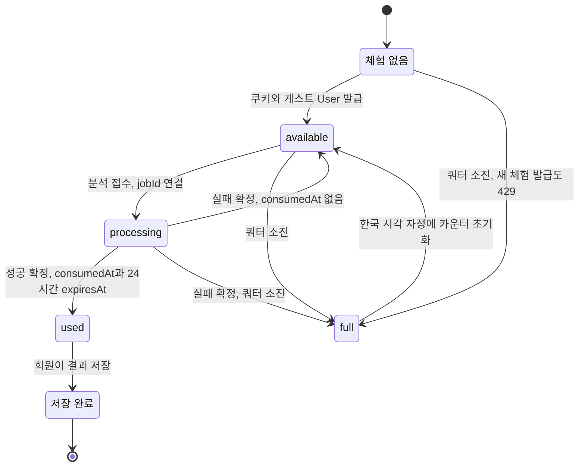

로그인하지 않은 방문자에게 한 번의 무료 분석을 주려면 세션 없이 "이 브라우저가 누구인지"를 증명할 방법이 필요해요. 이 저장소는 `GuestAnalysisTrial` 한 행과 그 행이 가리키는 게스트 `User`로 그 증명을 만들어요. 브라우저는 `copy-singer.guest-trial` 쿠키만 들고 다니고, 서버는 그 토큰의 해시로 trial을 찾아 분석 접수·결과 열람·회원 계정 이전을 모두 같은 행에 기록해요([trial.ts](repo://src/entities/guest-analysis/api/trial.ts#L21-L43)).

체험 흐름을 바꾸기 전에 확인할 축은 세 가지예요. 어떤 시각 컬럼이 상태를 만드는지, 일일 쿼터가 어디에 세어지는지, 그리고 결과의 소유권이 게스트 `User`에서 회원 `User`로 언제 넘어가는지예요. 이 페이지가 그 세 축의 단일 소유자이고, 세션·소유권 판정 함수는 [인증과 소유권 경계](../integrations/auth-and-ownership.md), 컬럼·제약은 [데이터 모델과 수명 주기 상태](../architecture/data-model.md)가 각각 맡아요.

## 체험 하나는 게스트 계정과 분석 작업 하나로 묶여요

체험은 `POST /api/guest-analysis`로 시작해요. 브라우저는 분석을 제출하기 직전에 이 요청을 먼저 보내고, 서버는 `Origin` 헤더가 `BETTER_AUTH_URL`의 origin과 같고 `Sec-Fetch-Site`가 `cross-site`가 아닐 때만 진행해요([guest-analysis-route.ts](repo://src/_app/api-routes/guest-analysis/guest-analysis-route.ts#L13-L20), [client.ts](repo://src/features/analyze-vocal-profile/api/client.ts#L61-L79)).

이 요청은 세 갈래로 갈라져요. handler는 먼저 `guest-start:{ip}` 키의 토큰 버킷을 확인하고, 이어서 세 갈래를 판단해요. 이미 로그인 세션이 있으면 `{ "status": "member" }`로 끝나고, 이 브라우저의 trial이 이미 있으면 새 행을 만들지 않고 `{ "status": "ready" }`만 돌려줘요. 둘 다 아니면 쿼터를 확인한 뒤 trial을 만들어요([guest-analysis-route.ts](repo://src/_app/api-routes/guest-analysis/guest-analysis-route.ts#L19-L40)). 신뢰 프록시 설정이 없으면 모든 요청이 `untrusted-ingress` 키를 공유하니, 이 버킷을 사용자별 제한으로 읽지 마세요. 요청 제한 그룹과 수치는 [HTTP API 표면과 요청 접수 규칙](../architecture/http-api-surface.md)이 정리해요.

`ready` 응답은 "이 브라우저의 trial 행을 찾았다"는 뜻일 뿐 새 분석을 받을 수 있다는 뜻이 아니에요. 성공한 뒤 보관 기간이 지난 trial은 증명으로는 여전히 통과하지만 `consumedAt`이 남아 있어 정책이 `used`가 되고 접수는 `GUEST_ANALYSIS_USED`로 거절돼요. 이미 저장된 trial은 `getAnalysisActor`가 아예 무시하므로 접수 route가 401을 돌려줘요([analysis-actor.ts](repo://src/features/authentication/api/analysis-actor.ts#L6-L13), [analysis-queue.ts](repo://src/features/analyze-vocal-profile/api/analysis-queue.ts#L100-L139)).

새 trial은 게스트 `User`와 함께 만들어져요. `createGuestTrial`은 32바이트 난수를 base64url로 인코딩한 43자 토큰을 만들고, DB에는 그 SHA-256 해시만 `tokenHash`로 저장해요. 게스트 `User`는 `guest-{uuid}` id, `isGuest: true`, 이름 `무료 분석`, `@anonymous.placeholder.invalid` 도메인 이메일을 가져요([trial.ts](repo://src/entities/guest-analysis/api/trial.ts#L30-L43)). 그래서 게스트 계정은 소유자 역할만 하고 로그인 주체는 되지 못해요. 세션 조회는 `null`이고, 티켓 지갑·원장 행이 생기지 않으며, 회원 전용 계정 티켓 API는 401로 끊겨요([guest-analysis.integration.ts](repo://tests/guest-analysis.integration.ts#L8-L36)).

쿠키는 `HttpOnly`, `SameSite=Lax`, `Path=/`, `Max-Age=31536000`(365일)로 내려가고 운영 환경에서만 `Secure`가 붙어요. 서버는 쿠키 값을 `/^[A-Za-z0-9_-]{43}$/`로 검사한 뒤 해시로 조회해요. 그래서 DB의 `tokenHash`를 그대로 쿠키에 넣어도 trial이 조회되지 않아요([trial.ts](repo://src/entities/guest-analysis/api/trial.ts#L7-L28)).

| 필드 | 의미 | 쓰는 주체 |
| --- | --- | --- |
| `tokenHash` | 브라우저 쿠키 토큰의 SHA-256. 토큰 원문은 저장하지 않아요 | `createGuestTrial` |
| `userId` | 이 체험을 소유한 게스트 `User`(1:1, cascade) | `createGuestTrial` |
| `jobId` | 연결된 분석 작업 하나(unique) | 접수 트랜잭션 |
| `consumedAt` | 성공 결과를 소비한 시각. 정리해도 지워지지 않아요 | 워커 성공 확정 |
| `expiresAt` | 결과 열람과 만료 정리의 기준 시각. 접수할 때 `null`로 비워요 | 접수, 확정, 저장, 정리 |
| `claimedAt`·`claimedByUserId` | 회원이 결과를 저장한 시각과 그 회원 | `claimGuestAnalysis` |

세 unique 제약(`tokenHash`·`userId`·`jobId`)이 "브라우저 하나에 trial 하나, trial 하나에 작업 하나"를 DB에서 보장해요([migration.sql](repo://prisma/migrations/20261029000000_guest_analysis_trial/migration.sql#L19-L29)). 이 제약과 FK 삭제 동작 자체는 [데이터 모델과 수명 주기 상태](../architecture/data-model.md)가 정리하니, 여기서는 상태를 만드는 데만 쓰세요.

## 상태 네 값은 저장된 열이 아니라 시각 컬럼에서 계산돼요

`guestAnalysisPolicy`는 trial과 쿼터 여유 여부를 받아 아래 우선순위로 `state`를 계산해요. 저장된 enum이 없으므로 상태를 바꾸려면 이 함수와 시각 컬럼을 함께 봐야 해요([lifecycle.ts](repo://src/entities/guest-analysis/api/lifecycle.ts#L19-L32), [contract.ts](repo://src/entities/guest-analysis/model/contract.ts#L1-L8)).

| `state` | 계산 조건(위에서부터 먼저 맞는 값) | 화면과 API에서의 의미 |
| --- | --- | --- |
| `used` | `consumedAt` 또는 `claimedAt`이 채워짐 | 무료 분석 기회를 이미 썼어요. 저장 전이면 결과를 보관 중이에요 |
| `processing` | 연결된 작업이 `PENDING`·`PROCESSING` | 새 접수를 받지 않고 완료를 기다려요 |
| `available` | 위 조건이 없고 쿼터에 여유가 있음 | 지금 접수할 수 있어요 |
| `full` | 위 조건이 없고 쿼터가 소진됨 | 오늘 몫이 끝났어요. 다음 한국 자정 뒤에 풀려요 |

`profileId`는 별도 규칙으로 채워요. `guestTrialIsReadable`이 참일 때만, 즉 `claimedAt`이 비어 있고 `expiresAt`이 없거나 미래일 때만 작업의 `vocalProfileId`를 돌려줘요. 그래서 상태가 `used`여도 만료 전이면 결과를 열 수 있고, 만료 뒤에는 상태는 `used`인 채 `profileId`만 `null`이 돼요([lifecycle.ts](repo://src/entities/guest-analysis/api/lifecycle.ts#L19-L32), [trial.ts](repo://src/entities/guest-analysis/api/trial.ts#L45-L47)).

체험 한 행이 거치는 상태예요. `available`과 `full`은 저장된 값이 아니라 쿼터 카운터까지 계산한 결과이고, 저장(`Claimed`)은 `used`에서만 가능해요. 보관 기한이 지난 `used`는 상태를 그대로 유지한 채 결과 열람만 막히므로 별도 상태로 그리지 않았어요.

정리 단계는 `consumedAt`을 지우지 않아요. 그래서 성공한 체험은 정리 뒤에도 `used`로 남고 새 접수는 계속 막혀요. 정리가 지우는 것은 프로필·녹음·자산이고, trial 행에서는 `expiresAt`만 `null`로 돌아가요([lifecycle.ts](repo://src/entities/guest-analysis/api/lifecycle.ts#L114-L132)). 반대로 실패로 끝난 trial은 `consumedAt`이 비어 있어서 오늘 쿼터가 남아 있으면 다음 접수를 다시 받을 수 있어요([guest-analysis.integration.ts](repo://tests/guest-analysis.integration.ts#L241-L248)).

## 일일 쿼터는 웹 프로세스 메모리에만 있어요

`GuestAnalysisQuota`는 `{ day, used }` 하나만 들고 있는 카운터예요. `day`는 현재 시각에 9시간을 더해 24시간으로 나눈 값이라 Asia/Seoul 자정에 경계가 생기고, 날짜가 바뀌는 순간 `used`가 0으로 돌아가요. `policy(limit)`의 `retryAfter`는 다음 한국 자정까지 남은 초예요([guest-quota.ts](repo://src/shared/lib/admission/guest-quota.ts#L3-L22)).

`reserve(limit)`는 슬롯 하나를 잡고 `commit`·`release` 두 함수를 돌려줘요. `release`는 두 번 불러도 한 번만 되돌리고, `commit`을 먼저 부르면 이후 `release`는 아무 일도 하지 않아요. 그래서 "되돌리기"와 "확정"이 겹쳐도 사용량이 두 번 줄거나 늘지 않아요([guest-quota.ts](repo://src/shared/lib/admission/guest-quota.ts#L24-L39), [guest-analysis-quota.test.ts](repo://tests/guest-analysis-quota.test.ts#L6-L21)).

이 카운터의 경계는 의도적으로 좁아요. 인스턴스는 `globalThis`에 붙여 같은 프로세스의 Route Handler 번들과 개발 리로드가 공유하지만, 별도 워커 프로세스나 다른 웹 인스턴스와는 공유되지 않아요. 재시작하면 0에서 다시 시작하고, 이미 잡은 예약은 잡았던 날짜의 버킷에 남아요([guest-quota.ts](repo://src/shared/lib/admission/guest-quota.ts#L42-L45), [guest-analysis-quota.test.ts](repo://tests/guest-analysis-quota.test.ts#L23-L40)). 그래서 한도는 서버 전체의 정확한 상한이 아니라 프로세스 단위 근사치예요. 여러 인스턴스로 늘리면 실제 허용량도 그만큼 늘어나요.

한도 값과 허용 범위는 `GUEST_ANALYSIS_DAILY_LIMIT`이 정하고([server-env.ts](repo://src/shared/config/server-env.ts#L30-L32)), [환경 변수와 런타임 한도](../operations/configuration.md)가 그 표를 소유해요. 값을 `0`으로 두면 신규 접수만 막히고, 이미 열어 둔 체험의 추천 조회는 계속 200으로 동작해요([guest-analysis.integration.ts](repo://tests/guest-analysis.integration.ts#L517-L527)).

## 접수는 예약을 잡은 뒤에만 작업을 만들어요

비회원 분석 접수는 `POST /api/vocal-profile-analysis-jobs` 한 곳으로 들어오고, 체험 경로는 아래 순서를 지켜요. 접수 API의 전체 단계와 워커 처리는 [보컬 프로필 분석 흐름](vocal-profile-analysis.md)이 설명하니, 여기서는 체험에만 걸리는 조건을 확인하세요.

1. `preflightVocalProfileAnalysis`가 같은 `(userId, idempotencyKey)` 작업을 먼저 찾아요. 있으면 새로 만들지 않고 그 작업을 `202`로 돌려주고, 체험이면 그 작업을 아직 읽을 수 있는지도 확인해 만료됐으면 `GUEST_RESULT_EXPIRED` 410을 던져요([analysis-queue.ts](repo://src/features/analyze-vocal-profile/api/analysis-queue.ts#L119-L139)).
2. 정책이 `used`면 `GUEST_ANALYSIS_USED` 409, `full`이고 예약이 없으면 `GUEST_ANALYSIS_DAILY_LIMIT` 429로 거절해요.
3. 이 시점에 `guestAnalysisQuota.reserve(...)`로 슬롯을 잡아요. 본문을 읽기 전에 거절하므로 큰 업로드가 무의미하게 소비되지 않아요.
4. 멀티파트 본문, `Idempotency-Key`, 오디오 MIME·크기를 검증해요.
5. `enqueueVocalProfileAnalysis`가 `Serializable` 트랜잭션에서 `lockQueueAdmission`을 잡고, 같은 키를 다시 확인한 뒤, 체험이면 `assertGuestCanSubmit`으로 trial 행을 `FOR UPDATE`로 잠그고 `consumedAt`·`claimedAt`과 진행 중 작업을 다시 검사해요. 그다음 활성 작업 0건과 큐 용량을 확인하고 작업 행을 만들어요([analysis-queue.ts](repo://src/features/analyze-vocal-profile/api/analysis-queue.ts#L170-L215), [lifecycle.ts](repo://src/entities/guest-analysis/api/lifecycle.ts#L34-L41)).
6. 같은 트랜잭션에서 `GuestAnalysisTrial.jobId`를 새 작업으로 바꾸고 `expiresAt`을 `null`로 비워요. 분석이 도는 동안에는 만료 정리 후보가 되지 않아요.

예약은 작업 행이 실제로 만들어졌을 때만 확정돼요. 이 구분이 사용량 규칙의 전부예요.

| 실패 지점 | 예약 처리 | 확인 방법 |
| --- | --- | --- |
| 본문 파싱, `Idempotency-Key`, MIME·크기 검증 실패 | `release`로 슬롯을 돌려줘요 | 잘못된 업로드 `400` 뒤 쿼터가 다시 `available`이에요([guest-analysis.integration.ts](repo://tests/guest-analysis.integration.ts#L419-L457)) |
| 같은 `Idempotency-Key` 재요청 | 새 예약을 잡지 않고 기존 작업을 반환해요 | 재요청도 `202`와 같은 `id`예요 |
| 트랜잭션 거절(`ANALYSIS_BUSY`, 큐 용량, `assertGuestCanSubmit`) | `release`로 슬롯을 돌려줘요 | 트랜잭션이 커밋되지 않았으므로 작업 행도 없어요 |
| 작업 행 생성 성공 | `commit`으로 사용량을 확정해요 | 이후 `release`가 불려도 되돌아가지 않아요([analysis-queue.ts](repo://src/features/analyze-vocal-profile/api/analysis-queue.ts#L212-L237)) |

즉 영속 작업이 만들어지기 전에 실패하면 오늘 몫을 돌려받고, 작업 행이 커밋된 뒤에 실패하면 사용량을 유지해요. 이 순서를 바꾸면 "작업 행 없는 사용량"이나 "사용량 없는 작업 행"이 생겨요.

## 성공 결과만 24시간 동안 읽을 수 있어요

작업이 끝나면 워커가 같은 확정 트랜잭션에서 `markGuestAnalysisTerminal`을 호출해요. 이 함수는 `userId`·`jobId`가 일치하고 `claimedAt`이 비어 있는 trial 행만 갱신하며, 성공이면 `consumedAt`을 지금 시각으로 채우고, 성패와 무관하게 `expiresAt`을 `GUEST_RESULT_RETENTION_MS`(24시간) 뒤로 옮겨요([lifecycle.ts](repo://src/entities/guest-analysis/api/lifecycle.ts#L43-L55), [contract.ts](repo://src/entities/guest-analysis/model/contract.ts#L3-L3)).

| 확정 결과 | `consumedAt` | `expiresAt` | 계산되는 상태 |
| --- | --- | --- | --- |
| `SUCCEEDED` | 지금 시각 | 지금 + 24시간 | `used` |
| `FAILED` | 비어 있음 | 지금 + 24시간 | 쿼터에 따라 `available` 또는 `full` |

실패 확정도 `expiresAt`을 채우므로 24시간 뒤 정리 후보가 돼요. 정리는 그 사용자에게 남아 있는 자산을 `scheduleAssetDeletion`으로 넘기고 trial의 `expiresAt`을 다시 `null`로 되돌려요. `consumedAt`은 비어 있으므로, 그때 쿼터가 남아 있으면 새 접수가 다시 열려요.

이 갱신은 알림 생성보다 먼저 실행되고, trial 행을 갱신했다면 함수가 `true`를 돌려줘 알림 생성을 건너뛰어요. 그래서 체험 계정에는 성공·실패 알림이 쌓이지 않아요([worker.ts](repo://src/_app/background-jobs/vocal-profile-analysis/worker.ts#L122-L127), [worker.ts](repo://src/_app/background-jobs/vocal-profile-analysis/worker.ts#L220-L221)).

결과를 읽는 경로는 한 함수로 모여요. `canReadGuestResource`는 그 사용자의 trial을 찾아 읽을 수 있는 상태인지 확인하고, 요청이 `jobId`를 지정하면 `trial.jobId`와, `profileId`를 지정하면 `trial.job.vocalProfileId`와 비교해요([trial.ts](repo://src/entities/guest-analysis/api/trial.ts#L49-L56)). 프로필 상세·오디오·합성 레퍼런스·작업 상세 route와 추천 조회 서비스가 모두 이 함수를 먼저 부르고, 어떤 증명으로 요청이 통과했는지는 [인증과 소유권 경계](../integrations/auth-and-ownership.md)가 정리해요([recommendation-service.ts](repo://src/features/create-recommendation/api/recommendation-service.ts#L101-L101)).

체험 사용자도 자기 결과를 직접 지울 수 있어요. `deleteGuestResult`는 trial 행을 잠그고 읽을 수 있는 상태에서 프로필 id가 일치하는지 확인한 뒤 `purgeGuestResult`를 불러요([lifecycle.ts](repo://src/entities/guest-analysis/api/lifecycle.ts#L134-L142)). `purgeGuestResult`는 진행 중 작업이 있으면 `GUEST_ANALYSIS_PROCESSING`으로 멈추고, 프로필과 녹음을 지운 다음 작업의 `sourceAssetId`를 비우고 남은 자산마다 `scheduleAssetDeletion`을 걸어요([lifecycle.ts](repo://src/entities/guest-analysis/api/lifecycle.ts#L114-L132)). 라우트는 삭제를 기다리지 않고 `202`와 `mediaCleanupPending: true`를 돌려주며, `consumedAt`은 그대로 남아 무료 분석 기회가 복구되지 않아요([vocal-profile-detail-route.ts](repo://src/_app/api-routes/vocal-profiles/vocal-profile-detail-route.ts#L68-L82)). 삭제 예약이 실제 외부 삭제로 이어지는 절차는 [미디어 저장과 정리 의도](../operations/media-storage.md)가 맡아요.

## 저장은 로그인 세션과 체험 쿠키를 함께 요구해요

결과 저장은 `POST /api/guest-analysis/claim`이 맡아요. 이 라우트는 admission 래퍼에 `allowGuest`를 넘기지 않아요. 그래서 세션이 없으면 handler에 닿기 전에 401로 끝나고, handler 안에서도 `requireApiSession`이 한 번 더 확인해요. handler는 요청 헤더의 쿠키에서 trial 증명을 따로 읽으므로, 로그인만 하고 쿠키가 없으면 `GUEST_TRIAL_NOT_FOUND` 404예요([guest-analysis-claim-route.ts](repo://src/_app/api-routes/guest-analysis/guest-analysis-claim-route.ts#L6-L27), [lifecycle.ts](repo://src/entities/guest-analysis/api/lifecycle.ts#L57-L59)). 접수 route와 같은 `requireSameOrigin` 검사도 그대로 통과해야 해요. 저장 화면 자체도 `/profile/save-trial` 페이지에서 `requirePageSession`을 먼저 통과하고 `next`를 그대로 넘겨받아요([save-trial-page.tsx](repo://src/_pages/profile/ui/save-trial-page.tsx#L4-L9)).

`claimGuestAnalysis`는 하나의 트랜잭션 안에서 아래 순서를 지켜요([lifecycle.ts](repo://src/entities/guest-analysis/api/lifecycle.ts#L57-L112)).

1. `GuestAnalysisTrial` 행을 `FOR UPDATE`로 잠그고, 저장하는 주체가 게스트가 아닌 회원인지 확인해요. 게스트면 `MEMBER_REQUIRED` 401이에요.
2. 이미 `claimedAt`이 있으면 같은 회원인지 먼저 봐요. 같은 회원이고 그 회원 소유 프로필이 남아 있으면 **새 프로필을 만들지 않고 같은 `profileId`를 그대로 돌려줘요.** 그래서 두 요청이 동시에 들어와도 결과는 하나의 프로필이에요([guest-analysis.integration.ts](repo://tests/guest-analysis.integration.ts#L316-L317)). 다른 회원이면 `GUEST_TRIAL_ALREADY_SAVED` 403이에요.
3. 아직 저장 전이면 작업이 `PENDING`·`PROCESSING`인지(`GUEST_ANALYSIS_PROCESSING`), 결과를 읽을 수 있는지(`GUEST_RESULT_EXPIRED`), `consumedAt`과 작업 `SUCCEEDED`·`vocalProfileId`가 모두 준비됐는지 차례로 확인해요.
4. 회원의 `nextVocalProfileNumber`를 1 올리고 그 값에서 1을 뺀 수를 프로필 번호로 써요. 프로필의 `userId`를 회원으로 바꾸고 `displayName`을 `보컬 프로필 {번호}`로 다시 써요.
5. 작업의 `userId`를 회원으로 옮기고 `idempotencyKey`를 `guest-claim:{trialId}:{jobId}`로 바꿔요. 회원이 이미 쓰던 접수 키와 충돌하지 않게 하려는 조치예요.
6. 원본 녹음과 합성 레퍼런스 자산의 `MediaAsset`·`MediaOperation` `userId`를 회원으로 옮겨요.
7. 마지막에 trial의 `claimedByUserId`·`claimedAt`을 채우고 `expiresAt`을 `null`로 비워요.

이 모든 단계가 한 트랜잭션이라 중간에 실패하면 아무 소유권도 넘어가지 않아요. 프로필·녹음·자산은 게스트 소유로, 작업 행은 게스트 `userId`와 원래 `idempotencyKey`로 남고 trial도 저장되지 않은 상태로 남아요. 그래서 사용자는 결과를 잃지 않고 다시 저장할 수 있어요. 회원 id가 존재하지 않는 경우를 확인한 테스트도 실패 뒤 작업 `userId`가 게스트로 남아 있는지 검사해요([guest-analysis.integration.ts](repo://tests/guest-analysis.integration.ts#L292-L299)). 라우트는 `GuestAnalysisError`가 아닌 예외를 `503`과 `GUEST_RESULT_SAVE_FAILED`(`retryable: true`)로 감싸고, 저장 화면은 "결과를 유지하고 있어요. 잠시 뒤 다시 시도해 주세요."를 보여 준 뒤 다시 시도 버튼을 남겨요([guest-analysis-claim-route.ts](repo://src/_app/api-routes/guest-analysis/guest-analysis-claim-route.ts#L14-L24), [save-trial.tsx](repo://src/_pages/profile/ui/save-trial.tsx#L36-L67)). 반대로 `GUEST_RESULT_EXPIRED`·`GUEST_RESULT_NOT_FOUND`·`GUEST_TRIAL_NOT_FOUND`·`GUEST_TRIAL_ALREADY_SAVED`는 다시 시도해도 결과가 달라지지 않으므로 화면이 재시도 버튼을 숨기고 "저장할 체험 결과를 찾지 못했어요"로 안내해요.

| 응답 `reasonCode` | HTTP | 뜻 |
| --- | --- | --- |
| `GUEST_TRIAL_NOT_FOUND` | 404 | 체험 쿠키가 없거나 형식이 맞지 않아요 |
| `MEMBER_REQUIRED` | 401 | 저장 주체가 게스트 계정이에요 |
| `GUEST_ANALYSIS_PROCESSING` | 409 | 분석이 아직 진행 중이에요 |
| `GUEST_RESULT_EXPIRED` | 410 | 보관 기간이 지났어요. 쿠키는 남아 있지만 결과는 없어요 |
| `GUEST_RESULT_NOT_FOUND` | 404 | 성공 결과나 옮길 프로필을 찾지 못했어요 |
| `GUEST_TRIAL_ALREADY_SAVED` | 403 | 다른 회원이 이미 저장했어요 |
| `GUEST_RESULT_SAVE_FAILED` | 503 | 예상하지 못한 오류예요. 원본은 그대로 있고 재시도할 수 있어요 |

저장이 끝나면 같은 trial은 더 이상 체험 증명으로 쓰이지 않아요. `getAnalysisActor`가 `claimedAt`이 있는 trial을 무시하므로, 이후 접근은 회원 세션과 회원 소유권으로만 이뤄져요([analysis-actor.ts](repo://src/features/authentication/api/analysis-actor.ts#L6-L13)).

## 복귀 경로는 저장한 프로필의 추천 화면으로 제한돼요

저장에 성공하면 브라우저는 원래 보던 추천 화면으로 돌아가고 싶어 해요. 그런데 `next` 값은 URL에서 오므로 외부 사이트나 재귀 저장 화면으로 튈 수 있어요. 이 저장소는 두 함수로 후보를 좁혀요([navigation.ts](repo://src/entities/guest-analysis/model/navigation.ts#L1-L19)).

`guestRecommendationReturn(profileId, candidate)`는 `profileId`가 UUID 형식이 아니면 `/profile`을 돌려줘요. 맞으면 `/recommendations/{profileId}` 또는 `/recommendations/{profileId}/songs/{곡 UUID}`와 정확히 일치하는 후보만 통과시키고, 나머지는 `/vocal-profiles/{profileId}`로 떨어뜨려요. 후보에 CR·LF가 섞여 있으면 비교 전에 잘라내지 않고 바로 기본 경로로 보내요.

`guestRecommendationSaveHref(profileId, itemId, signedIn)`는 같은 검사를 통과한 경로를 `/profile/save-trial?next=...`로 인코딩하고, 로그인 전이면 그 주소를 다시 `/login?callbackURL=...`로 감싸요. 그래서 로그인 화면을 거쳐도 선택한 곡까지 유지돼요([guest-analysis-navigation.test.ts](repo://tests/guest-analysis-navigation.test.ts#L8-L20)).

| 후보 | 결과 |
| --- | --- |
| `/recommendations/{profileId}` | 그대로 통과 |
| `/recommendations/{profileId}/songs/{곡 UUID}` | 그대로 통과 |
| 없음, CR·LF 포함 | `/vocal-profiles/{profileId}` |
| `https://evil.example`, `//evil.example`, `javascript:alert(1)` | `/vocal-profiles/{profileId}` |
| `/profile/save-trial`(재귀), 다른 프로필의 추천 경로 | `/vocal-profiles/{profileId}` |
| 곡 id가 UUID가 아님, `?next=...` 쿼리, `#fragment`, `%2f` 인코딩, `..` 경로 이동 | `/vocal-profiles/{profileId}` |
| `profileId` 자체가 UUID가 아님 | `/profile` |

저장 화면은 서버가 돌려준 `profileId`에 대해 `guestRecommendationReturn`을 한 번 더 적용한 뒤 `router.replace`로 이동해요. 서버 응답이 조작돼도 같은 허용 목록을 다시 통과해야 하니, 이 이중 검사를 하나로 줄이지 마세요([save-trial.tsx](repo://src/_pages/profile/ui/save-trial.tsx#L18-L34)).

## 만료 정리는 분석 워커의 유휴 반복이 맡아요

만료 정리는 별도 스케줄러가 아니라 보컬 분석 워커 러너의 레인 0이 실행해요. 레인 0은 5초에 한 번 `cleanupExpiredGuestAnalysis()`와 `processOneMediaCleanup()`을 차례로 부르고, 점유·lease·재시도 규칙은 [Job 큐와 lease 복구 계약](../operations/job-processing.md)이 소유해요([runner.ts](repo://src/_app/background-jobs/vocal-profile-analysis/runner.ts#L22-L35)).

`cleanupExpiredGuestAnalysis`는 트랜잭션 하나에서 `claimedAt IS NULL AND expiresAt <= now`인 행을 `expiresAt` 순으로 정렬해 `FOR UPDATE SKIP LOCKED LIMIT 1`로 한 건만 집어요. 다른 정리 프로세스가 잡은 행은 건너뛰므로 여러 인스턴스가 동시에 돌아도 같은 행을 두 번 지우지 않아요. 집어 온 행은 `purgeGuestResult`가 처리하고, 처리했으면 `true`, 후보가 없으면 `false`를 돌려줘요([lifecycle.ts](repo://src/entities/guest-analysis/api/lifecycle.ts#L144-L158)).

`purgeGuestResult`는 지우기 전에 진행 중 작업이 있는지 다시 봐요. 있으면 `GUEST_ANALYSIS_PROCESSING`으로 멈춰 분석 중인 결과를 지우지 않고, 없으면 프로필과 녹음을 지우고 작업의 `sourceAssetId`를 비운 뒤 남은 자산마다 `scheduleAssetDeletion`을 걸어요. 이 호출은 회원 프로필 삭제가 쓰는 것과 같은 예약 경로라서, 외부 스토리지 삭제를 다시 구현하지 않아요([lifecycle.ts](repo://src/entities/guest-analysis/api/lifecycle.ts#L114-L132)).

저장이 끝난 trial은 정리 대상이 아니에요. `claimedAt`이 채워져 후보 조회에서 빠지므로, 회원에게 넘어간 프로필은 보관 기한이 지나도 정리되지 않아요. 저장 뒤 정리를 실행해도 회원 프로필이 남아 있는지가 테스트로 고정돼 있어요([guest-analysis.integration.ts](repo://tests/guest-analysis.integration.ts#L336-L338)).

## 체험은 추천 조회까지, AI 믹싱은 회원 전용이에요

체험 결과로 할 수 있는 일은 프로필·추천 조회까지예요. 만료 전이면 추천 목록·상세를 그대로 읽을 수 있고, 이 조회는 외부 서비스를 부르거나 쿼터·티켓·작업을 건드리지 않아요([guest-analysis.integration.ts](repo://tests/guest-analysis.integration.ts#L489-L588)). 반면 AI 믹싱 작업 접수는 정식 회원 전용이라 체험 요청은 401로 끊기고, 화면은 티켓 확인 버튼 대신 로그인·저장 링크를 그려요([guest-analysis.integration.ts](repo://tests/guest-analysis.integration.ts#L580-L584), [recommendation-mixing-action.tsx](repo://src/features/create-mixing/ui/recommendation-mixing-action.tsx#L38-L57)). 믹싱 접수 조건과 체험 화면의 안내 문구는 [AI 믹싱 흐름](ai-mixing.md)이 정리해요.

## 체험 흐름을 바꿀 때 지킬 규칙

- 쿠키 토큰은 원문을 저장하지 마세요. 조회는 `hashGuestToken`을 거친 `tokenHash`로만 하고, 그래서 DB의 해시 값을 쿠키에 넣어도 trial이 열리지 않아요([trial.ts](repo://src/entities/guest-analysis/api/trial.ts#L7-L28)). 43자 형식 검사도 함께 유지하세요. 형식이 어긋난 값은 해시 조회 전에 걸러져 불필요한 DB 조회가 생기지 않아요.
- 상태를 새로 추가하려면 `guestAnalysisPolicy`의 우선순위, `guestTrialIsReadable`, `canReadGuestResource`를 함께 고치세요. 한 곳만 바꾸면 목록 상태와 실제 열람 가능 여부가 어긋나요.
- 쿼터를 전역 상한으로 만들려면 `GuestAnalysisQuota`를 프로세스 메모리에서 꺼내야 해요. 지금 구조는 웹 인스턴스와 워커 사이에서 공유되지 않는 근사치예요([guest-quota.ts](repo://src/shared/lib/admission/guest-quota.ts#L42-L45)).
- 예약 정산 순서를 유지하세요. `reserve`는 본문을 읽기 전에, `commit`은 작업 행이 커밋된 직후에, `release`는 실패 경로의 `finally`에 있어야 해요.
- `assertGuestCanSubmit`의 `FOR UPDATE` 잠금을 빼지 마세요. 접수 트랜잭션 두 개가 같은 trial을 동시에 통과하면 작업이 두 개 생길 수 있어요.
- 저장 트랜잭션은 프로필·작업·자산의 `userId`를 모두 옮겨야 해요. 하나를 빠뜨리면 저장된 결과의 원본 음성을 게스트 소유로 읽으려다 404가 나요.
- 저장 실패를 "결과 삭제"로 처리하지 마세요. 실패는 롤백이고, 사용자가 직접 지우거나 만료 정리가 실행될 때만 원본이 사라져요.
- 만료 정리는 `scheduleAssetDeletion`을 재사용하세요. 별도 삭제 루틴을 만들면 `MediaOperation` 상태 추적이 갈라져요.

## 다음에 볼 문서

- 세션·관리자·체험 증명이 각각 어떤 요청을 통과시키는지: [인증과 소유권 경계](../integrations/auth-and-ownership.md)
- `GuestAnalysisTrial` 컬럼·unique 제약·FK 삭제 동작: [데이터 모델과 수명 주기 상태](../architecture/data-model.md)
- 워커 점유·lease·재시도와 정리 호출 지점: [Job 큐와 lease 복구 계약](../operations/job-processing.md)
- 화면이 `guest` 정책 값으로 분기하는 지점: [브라우저 상태와 API 오류 계약](../architecture/client-data-flow.md)
- 체험 계정이 티켓 원장 밖에 있다는 경계: [티켓 원장과 멱등성](../concepts/ticket-ledger.md)
- 체험 분석에 알림이 생기지 않는 이유: [알림과 중복 방지](../concepts/notifications.md)
- 체험 목록의 관리자 화면 노출 필드: [관리자 콘솔과 커스텀 믹싱](../operations/admin-console.md)
- 이 흐름을 검증하는 검사 선택: [변경 검증 경로](../testing/verification.md)
