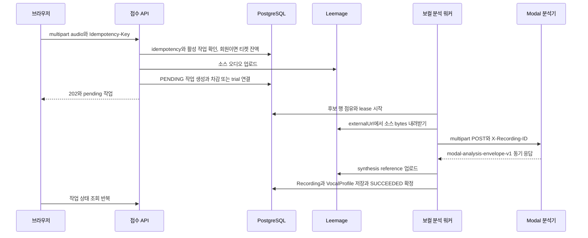
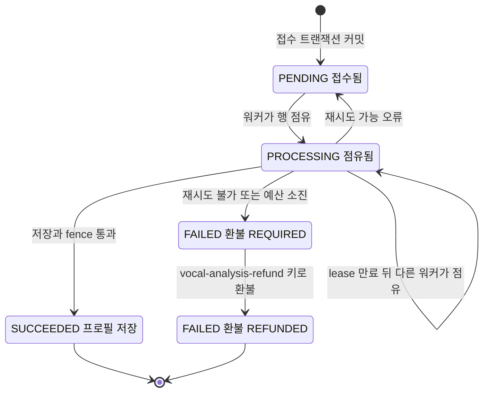

# 보컬 프로필 분석 흐름

접수·처리·종료 중 한 단계를 바꾸려면 이 페이지의 순서와 상태를 먼저 확인하세요. 오디오 한 건은 두 단계로 나뉘어 VocalProfile이 돼요. 먼저 접수 API가 소스를 Leemage에 올리고 PostgreSQL에 `PENDING` 작업 행과 티켓 차감(체험이면 trial 연결)을 함께 남겨요. 그다음 워커가 그 행을 점유해 Modal에 한 번 동기 호출을 보내고, 응답으로 받은 수치와 파일을 그대로 프로필 행으로 저장해요. 브라우저가 보는 것은 "오디오 전송"과 "분석 상태 조회" 두 가지뿐이고, 실제 분석은 요청과 분리된 워커 프로세스에서 진행돼요.

아래에서는 세 단계에서 지켜야 할 순서와 그 사이에 남는 상태를 짚어요. 점유·lease·재시도 알고리즘 자체는 [Job 큐와 lease 복구 계약](../operations/job-processing.md)이, Modal 서비스의 입력·인증 계약은 [Modal 서비스와 외부 계약](../integrations/modal-services.md)이 소유해요. 여기서는 이 흐름에 필요한 조건만 확인하고 링크해요.

접수 API가 큐를 만들고 워커가 Modal 호출과 저장을 끝내는 순서예요. Modal 구간에는 외부 작업 ID도 poll 반복도 없어요.

## 업로드 한도와 비용

값을 바꾸려면 이 표의 출처를 고치세요. 서버가 파일을 받기 전에 브라우저도 같은 상한을 검사해요([vocal-profile-workbench.tsx](repo://src/_pages/profile/ui/vocal-profile-workbench.tsx#L216-L219)).

| 항목 | 값 | 출처 |
| --- | --- | --- |
| 최대 오디오 크기 | 25MiB(`MAX_AUDIO_BYTES` = `25 * 1024 * 1024`) | [analysis-queue.ts](repo://src/features/analyze-vocal-profile/api/analysis-queue.ts#L53-L53), [contract.ts](repo://src/features/analyze-vocal-profile/model/contract.ts#L4-L4) |
| multipart 요청 본문 상한 | 파일 상한 + 1MiB 오버헤드 | [multipart.server.ts](repo://src/shared/api/multipart.server.ts#L11-L15) |
| 지원 MIME | `audio/wav`, `audio/x-wav`, `audio/mpeg`, `audio/mp4`, `audio/aac`, `audio/x-m4a`, `audio/webm` | [upload-formats.ts](repo://src/shared/lib/audio/upload-formats.ts#L3-L11) |
| 티켓 비용 | `VOCAL_PROFILE_ANALYSIS_TICKET_COST` 기본 1 | [server-env.ts](repo://src/shared/config/server-env.ts#L26-L28) |
| 워커 최대 시도 횟수 | `VOCAL_PROFILE_ANALYSIS_MAX_ATTEMPTS` 기본 3 | [server-env.ts](repo://src/shared/config/server-env.ts#L54-L56) |
| lease 길이 | `VOCAL_PROFILE_ANALYSIS_LEASE_SECONDS` 기본 300초 | [server-env.ts](repo://src/shared/config/server-env.ts#L58-L60) |
| 워커 동시성 | `VOCAL_PROFILE_ANALYSIS_WORKER_CONCURRENCY` 기본 1 | [server-env.ts](repo://src/shared/config/server-env.ts#L50-L52) |

브라우저는 제출 전에 선택한 오디오를 60초로 자르고 16kHz 모노로 다시 인코딩해요. 그래서 서버가 받는 파일은 사용자가 고른 원본과 크기·포맷이 다를 수 있어요([profile-upload.ts](repo://src/shared/lib/audio/profile-upload.ts#L1-L6), [profile-upload.ts](repo://src/shared/lib/audio/profile-upload.ts#L51-L129)).

## 접수: 작업 행과 차감을 한 트랜잭션에서 확정해요

브라우저는 `POST /api/vocal-profile-analysis-jobs`에 `audio` 파일과 `Idempotency-Key` 헤더를 보내고, 성공하면 `202`와 소문자 상태로 직렬화한 작업을 받아요([client.ts](repo://src/features/analyze-vocal-profile/api/client.ts#L61-L79)). 요청 처리 순서는 이래요([vocal-profile-analysis-jobs-route.ts](repo://src/_app/api-routes/vocal-profiles/vocal-profile-analysis-jobs-route.ts#L96-L111), [analysis-queue.ts](repo://src/features/analyze-vocal-profile/api/analysis-queue.ts#L119-L237)).

1. `getAnalysisActor`로 세션 또는 아직 저장되지 않은(`claimedAt`이 빈) 체험 trial을 확인하고, 둘 다 없으면 401로 끝내요.
2. `Idempotency-Key`를 trim해 1자 이상 200자 이하인지 보고, 아니면 `INVALID_IDEMPOTENCY_KEY` 400이에요.
3. 같은 `(userId, idempotencyKey)` 작업이 이미 있으면 새로 만들지 않고 그 작업을 `202`로 돌려줘요. 체험이면 그 작업을 아직 읽을 수 있는지도 확인해서, 만료됐으면 `GUEST_RESULT_EXPIRED` 410이에요.
4. 다른 요청 키로 진행 중인 작업이 있으면 `ANALYSIS_BUSY` 429에 `Retry-After: 10`이 붙어요.
5. 정책을 다시 읽어 회원은 티켓 잔액이 비용보다 적으면 `INSUFFICIENT_ANALYSIS_TICKETS` 402로, 체험은 `used`면 `GUEST_ANALYSIS_USED` 409로, 쿼터가 `full`이고 예약이 없으면 `GUEST_ANALYSIS_DAILY_LIMIT` 429로 거절해요.
6. 체험이면 이 시점에 `guestAnalysisQuota.reserve(...)`로 쿼터 슬롯을 잡아요. 본문을 읽기 전에 거절하므로 큰 업로드가 무효 처리되지 않아요.
7. multipart 본문을 상한 안에서 읽고 `analysisAudioFileSchema`로 파일 타입·크기를 검사해요. 오디오가 아니면 `UNSUPPORTED_AUDIO` 415, 상한 초과면 `PAYLOAD_TOO_LARGE` 413이에요.
8. `storeAnalyzerReferenceBytes`로 Leemage에 올려 `REFERENCE` 미디어 자산 행을 만들어요.
9. `Serializable` 트랜잭션에서 `lockQueueAdmission(tx, "VOCAL")`로 접수 lock을 잡고, 같은 키의 작업을 다시 확인한 다음, 체험이면 `assertGuestCanSubmit`, 그다음 활성 작업 0건과 큐 용량을 확인하고 작업을 `PENDING`으로 만들어요. 회원은 `ticketCost > 0`일 때 `vocal-analysis:debit:{userId}:{요청키}` 키로 `USAGE_DEBIT`을 적용하고, 체험은 `GuestAnalysisTrial.jobId`와 `expiresAt`을 갱신해요.

접수 트랜잭션은 Prisma `P2034`나 `TransactionWriteConflict`·`write conflict`·`deadlock` 메시지를 만나면 최대 3번째 시도까지 다시 실행하고, 세 번 다 실패하면 `ANALYSIS_ENQUEUE_FAILED`로 끝나요([analysis-queue.ts](repo://src/features/analyze-vocal-profile/api/analysis-queue.ts#L170-L230)). route가 `preflightVocalProfileAnalysis`를 먼저 호출하고 `enqueueVocalProfileAnalysis`가 같은 검사를 다시 하는 이유도 같은 경합 때문이에요. 앞선 검사만으로는 두 요청 사이의 상태 변화를 막을 수 없어서, 트랜잭션 안에서 다시 세는 검사가 최종 판정이 돼요.

### 회원 경로와 체험 경로는 어디서 갈라지나

두 경로는 같은 `enqueueVocalProfileAnalysis`를 지나지만, 정책 조회·검사·트랜잭션 쓰기가 아래 지점에서 갈라져요. 체험 쿼터·만료·결과 저장 수명 주기는 [비회원 체험 분석 흐름](guest-analysis-trial.md)이 소유하니 여기서 다시 정의하지 않아요.

| 지점 | 회원 경로 | 체험 경로 |
| --- | --- | --- |
| `getVocalProfileAnalysisPolicy` | `analysisTickets`에 지갑 잔액과 `VOCAL_PROFILE_ANALYSIS_TICKET_COST`를 담아요 | `balance: 0`, `cost: 0`에 `guest` 정책(`available`·`used`·`full`·`processing`)을 함께 담아요 |
| `preflightVocalProfileAnalysis` 추가 검사 | 잔액 < 비용이면 `InsufficientTicketsError` → 402 | `used`면 `GUEST_ANALYSIS_USED`, `full`이고 예약이 없으면 `GUEST_ANALYSIS_DAILY_LIMIT` 429 |
| 쿼터 예약 | 없어요 | route가 `guestAnalysisQuota.reserve(...)` 결과를 `guestReservation`으로 넘기고 `finally`에서 `release()`해요 |
| 트랜잭션 안 잠금 | `lockQueueAdmission` 뒤 활성 행 수와 큐 용량만 확인해요 | 같은 lock 뒤에 `assertGuestCanSubmit`이 `GuestAnalysisTrial` 행을 `FOR UPDATE`로 잠그고, 진행 중 작업이 있으면 `ANALYSIS_BUSY`를 던져요 |
| 작업 행 생성 뒤 | `ticketCost > 0`이면 `USAGE_DEBIT` 원장 행을 남겨요 | 차감 없이 trial의 `jobId`를 새 작업으로 바꾸고 `expiresAt`을 `null`로 되돌려요 |

`policy.guest` 분기는 업로드 전에 읽은 정책 객체를 트랜잭션 안에서도 그대로 쓰지만, 체험 경로는 같은 트랜잭션의 `assertGuestCanSubmit`이 trial 행을 다시 잠그고 상태를 재확인해요. 그래서 체험 접수는 티켓 원장을 건드리지 않고, 회원 접수만 차감·환불 대상이 돼요([analysis-queue.ts](repo://src/features/analyze-vocal-profile/api/analysis-queue.ts#L100-L117), [analysis-queue.ts](repo://src/features/analyze-vocal-profile/api/analysis-queue.ts#L147-L215), [lifecycle.ts](repo://src/entities/guest-analysis/api/lifecycle.ts#L34-L41)).

### 접수 진입점 두 곳과 응답 차이

`POST /api/vocal-profile-analysis-jobs`와 `POST /api/vocal-profiles`는 모두 같은 `enqueueVocalProfileAnalysis`를 호출해서 작업 행 생성과 차감 규칙을 공유해요. 다만 앞단 검증과 오류 매핑은 같지 않아요.

| 진입점 | 인증 | 체험 예약 | 본문 검증 | 티켓 부족 응답 |
| --- | --- | --- | --- | --- |
| `POST /api/vocal-profile-analysis-jobs` | `getAnalysisActor`(세션 또는 체험) | 넘겨요 | `readBoundedMultipartFormData` 뒤 `analysisIdempotencyKeySchema`·`analysisAudioFileSchema` | 402 `INSUFFICIENT_ANALYSIS_TICKETS` |
| `POST /api/vocal-profiles` | `requireApiSession`만 | 넘기지 않아요 | `readBoundedMultipartFormData` 뒤 `audio`가 `File`인지만 확인하고, 형식·크기는 `enqueueVocalProfileAnalysis` 안에서 검사해요 | 매핑이 없어 503 `ANALYSIS_ENQUEUE_FAILED` |

두 route 모두 `AdmissionError`는 `admissionResponse`로, `INVALID_IDEMPOTENCY_KEY`·`UNSUPPORTED_AUDIO`·`PAYLOAD_TOO_LARGE`·`ANALYSIS_BUSY`는 같은 코드의 400·415·413·429로 바꿔요. 차이는 티켓 부족 처리예요. `/api/vocal-profile-analysis-jobs`만 `InsufficientTicketsError`를 402로 매핑하고, `/api/vocal-profiles`는 그 오류를 알지 못해 공통 분기의 503(`retryable: true`)으로 돌려줘요([vocal-profiles-route.ts](repo://src/_app/api-routes/vocal-profiles/vocal-profiles-route.ts#L26-L61), [vocal-profile-analysis-jobs-route.ts](repo://src/_app/api-routes/vocal-profiles/vocal-profile-analysis-jobs-route.ts#L26-L73)).

### 실패한 접수는 자산을 남기지 않아요

8번(Leemage 업로드)과 9번(트랜잭션) 사이가 이 경로의 약한 지점이에요. 그래서 트랜잭션이 실패하거나 경쟁에서 밀리면 이미 올린 자산을 `discardMediaAsset`으로 폐기해요. 같은 키 경쟁에서 `P2002`가 나도 그 키의 작업이 이미 있으면 자산을 버리고 그 작업을 돌려줘요. 작업 행 생성에 성공한 경우에만 반환된 `job`을 응답에 쓰므로, 실패한 접수는 작업 행도 티켓 차감도 참조되지 않는 자산도 남기지 않아요([analysis-queue.ts](repo://src/features/analyze-vocal-profile/api/analysis-queue.ts#L157-L236), [media-service.ts](repo://src/shared/media/media-service.ts#L75-L85)).

키가 다른 두 요청이 동시에 들어오면 정확히 한 건만 작업 행을 만들어요. 테스트에서는 두 요청이 각각 Leemage 업로드까지 마친 뒤, 접수 트랜잭션 안의 `lockQueueAdmission`이 두 트랜잭션을 직렬화해요. 뒤에 들어간 요청은 활성 작업 수 검사에서 `ANALYSIS_BUSY`로 실패해요. 그래서 남는 작업 행과 미디어 자산은 각각 하나이고, 실패한 요청이 올렸던 자산은 지워져요([tests/vocal-profile-analysis-queue.integration.ts](repo://tests/vocal-profile-analysis-queue.integration.ts#L340-L411)).

활성 작업 1건 제한은 여러 겹으로 강제돼요. `preflightVocalProfileAnalysis`가 `PENDING`·`PROCESSING` 행을 세고, 접수 트랜잭션이 `lockQueueAdmission` 뒤에 같은 수를 다시 세며, DB에는 `status`가 그 두 값일 때만 걸리는 부분 unique 인덱스 `VocalProfileAnalysisJob_one_active_per_user`가 있어요. 사용자별 큐 용량(`VOCAL_USER_QUEUE_CAPACITY` 기본 1)도 같은 상태 집합을 세므로 이 제한과 겹쳐요([analysis-queue.ts](repo://src/features/analyze-vocal-profile/api/analysis-queue.ts#L79-L87), [analysis-queue.ts](repo://src/features/analyze-vocal-profile/api/analysis-queue.ts#L170-L184), [migration.sql](repo://prisma/migrations/20260814185000_vocal_analysis_active_admission/migration.sql#L1-L4), [queue.ts](repo://src/shared/lib/admission/queue.ts#L7-L23)).

## 워커: 점유 → Modal 동기 호출 → 저장

워커 러너는 별도 프로세스로 돌고, 레인마다 매 반복 남은 환불을 먼저 재처리한 뒤 작업 하나를 점유해요. 레인 0은 5초에 한 번 체험 결과 만료 정리와 미디어 정리도 실행해요([runner.ts](repo://src/_app/background-jobs/vocal-profile-analysis/runner.ts#L22-L35), [package.json](repo://package.json#L20-L20)). 점유된 작업 하나는 이 순서로 처리돼요([worker.ts](repo://src/_app/background-jobs/vocal-profile-analysis/worker.ts#L244-L347)).

1. `startJobLease`가 소유권을 다시 확인하고 heartbeat 갱신, deadline 타이머, 외부 호출에 전파할 `AbortSignal`을 함께 만들어요. 이 작업의 `deadlineAt`은 처음 점유될 때 `now + 15분`으로 채워지고 재시도해도 늘어나지 않아요([worker.ts](repo://src/_app/background-jobs/vocal-profile-analysis/worker.ts#L48-L84), [lease.ts](repo://src/shared/lib/runtime/lease.ts#L38-L97)).
2. 같은 `recordingId`의 프로필이 이미 저장돼 있으면 분석을 다시 하지 않고 `SUCCEEDED`로 맞춰요. 이전 워커가 저장까지 마치고 죽은 경우를 되돌리는 경로예요([worker.ts](repo://src/_app/background-jobs/vocal-profile-analysis/worker.ts#L260-L267)).
3. 재시도 예산을 넘겼으면 분석을 시작하지 않고 `JobDeadlineError`로 끝내요([worker.ts](repo://src/_app/background-jobs/vocal-profile-analysis/worker.ts#L269-L270)).
4. `sourceAssetId`가 가리키는 `REFERENCE` 자산이 `READY`인지 확인하고, 그 `externalUrl`에서 소스 bytes를 60초 타임아웃으로 내려받아요. 자산이 사라졌으면 `ANALYSIS_SOURCE_MISSING`(재시도 불가)이고, 다운로드가 실패하면 `ANALYSIS_SOURCE_UNAVAILABLE`인데 429와 5xx만 재시도 대상이에요([worker.ts](repo://src/_app/background-jobs/vocal-profile-analysis/worker.ts#L272-L302)).
5. `analyzeVocalProfileBytes`가 multipart 요청을 만들어 Modal `POST /v1/analyze`를 한 번 호출하고 응답을 기다려요. 요청 타임아웃은 120초이고, `X-Recording-ID`와 `X-API-Key` 헤더를 붙여요([analyzer/index.ts](repo://src/entities/vocal-profile/api/analyzer/index.ts#L27-L50), [modal-adapter.ts](repo://src/entities/vocal-profile/api/analyzer/modal-adapter.ts#L169-L196)).
6. 응답 envelope를 검증하고, 내려받은 소스 bytes와 응답의 `artifacts.source`가 크기와 SHA-256에서 같은지 워커가 다시 확인해요. 다르면 `ANALYZER_SOURCE_MISMATCH`로 실패시켜요([worker.ts](repo://src/_app/background-jobs/vocal-profile-analysis/worker.ts#L304-L317)).
7. `persistQueuedAnalyzedVocalProfile`이 Recording과 VocalProfile을 만들고, 같은 트랜잭션에서 `SUCCEEDED` 확정과 `VOCAL_PROFILE_SUCCEEDED` 알림을 함께 써요. 체험 trial이면 알림 대신 trial 확정만 하고 끝나는데, 그 판정은 [비회원 체험 분석 흐름](guest-analysis-trial.md)이 소유해요([persistence.ts](repo://src/entities/vocal-profile/api/persistence.ts#L153-L292), [worker.ts](repo://src/_app/background-jobs/vocal-profile-analysis/worker.ts#L95-L140)).

Modal 구간에는 외부 작업 ID 저장도 상태 poll도 없어요. `VocalProfileAnalysisJob`에는 `externalJobId` 컬럼이 없어서([schema.prisma](repo://prisma/schema.prisma#L560-L595)) 워커는 응답 본문을 그 자리에서 쓰고, 이 호출이 접수됐는지 확인하는 일은 응답 envelope 검증이 맡아요. 테이블에 `submissionState`·`submissionStartedAt` 컬럼은 있지만 보컬 분석 코드는 두 값을 쓰지 않아서 작업 행에는 기본값 `NOT_SUBMITTED`·`null`이 남아요. 그 두 값을 채우는 것은 외부 작업 ID를 저장하는 믹싱·곡 분석 경로예요([mixing/worker.ts](repo://src/_app/background-jobs/mixing/worker.ts#L437-L443), [song-analysis/worker.ts](repo://src/_app/background-jobs/song-analysis/worker.ts#L199-L204)). 곡 분석·믹싱과의 계약 차이는 [Modal 서비스와 외부 계약](../integrations/modal-services.md)에 정리돼 있어요.

### 응답 envelope 검증 조건

adapter는 `transportVersion`이 `modal-analysis-envelope-v1`이고 `cleanupConfirmed`가 정확히 `true`인지 먼저 봐요. 그다음 artifact마다 `contentBase64`를 디코딩한 bytes의 길이와 SHA-256이 `sizeBytes`·`sha256`과 같은지, `source`의 MIME과 크기가 `profile`의 값과 같은지, `profile.synthesisReference`가 있으면 그 descriptor와 artifact가 서로 맞는지를 차례로 확인해요. 이 조건이 어긋나면 `ANALYZER_INVALID_RESPONSE` 502로 끝나고 저장은 시작되지 않아요([modal-adapter.ts](repo://src/entities/vocal-profile/api/analyzer/modal-adapter.ts#L88-L143)). `profile.recordingId`가 요청한 id와 다르면 `ANALYSIS_FAILED` 502로 거절해요. 이 id는 adapter와 `analyzeVocalProfile`이 각각 확인해서, 다른 녹음의 결과가 이 작업의 프로필로 저장되는 일을 막아요([modal-adapter.ts](repo://src/entities/vocal-profile/api/analyzer/modal-adapter.ts#L104-L107), [analyzer/index.ts](repo://src/entities/vocal-profile/api/analyzer/index.ts#L11-L25)).

| 응답 상황 | 코드와 재시도 여부 |
| --- | --- |
| 분석기가 거절(예: `TOO_SILENT` 422) | 응답의 `reasonCode`를 그대로 쓰고 재시도하지 않아요 |
| 인증 실패 401·403 | `ANALYZER_AUTH_FAILED`, 재시도 불가 |
| 분석기 혼잡 429 | `ANALYZER_BUSY`, 재시도 가능 |
| 5xx 또는 네트워크 오류 | `ANALYZER_UNAVAILABLE`, 재시도 가능 |
| 120초 초과 | `ANALYZER_TIMEOUT`, 재시도 가능 |
| envelope 불일치 | `ANALYZER_INVALID_RESPONSE`, 재시도 가능 |
| 스마트 레퍼런스 계약 미지원 | `ANALYZER_UPDATE_REQUIRED`, 재시도 불가. 오래된 분석기를 배포한 상태라 응답 자체는 유효하지만 저장하지 않아요([analyzer/index.ts](repo://src/entities/vocal-profile/api/analyzer/index.ts#L11-L25)) |

adapter는 이 분류를 하고 나면 다시 호출하지 않아요. 재시도는 워커가 `attempts`와 `retryable`로 판단하므로, 호출 횟수를 늘리려면 adapter가 아니라 워커 계층을 고치세요([modal-adapter.ts](repo://src/entities/vocal-profile/api/analyzer/modal-adapter.ts#L145-L167), [tests/vocal-profile-analyzer-adapter.test.ts](repo://tests/vocal-profile-analyzer-adapter.test.ts#L154-L231)).

## 저장: 큐에 올린 소스를 재사용하고 합성 레퍼런스를 따로 올려요

저장 단계는 오디오를 다시 올리지 않아요. 접수 때 만든 `REFERENCE` 자산을 그대로 `Recording.mediaAsset`에 연결하고, `Recording.id`는 작업의 `recordingId`와 같은 값으로 만들어요. 그래서 `Recording`과 `VocalProfileAnalysisJob` 사이에 FK가 없어도 두 행이 같은 id 규약으로 연결돼요([persistence.ts](repo://src/entities/vocal-profile/api/persistence.ts#L232-L271), [데이터 모델과 수명 주기 상태](../architecture/data-model.md)).

프로필 번호는 `User.nextVocalProfileNumber`를 트랜잭션 안에서 1 증가시켜 배정하고, 표시 이름은 `보컬 프로필 {번호}`로 만들어요. 수치 컬럼과 `descriptors` JSON, `analyzer`·`analyzerVersion`은 응답 값을 그대로 옮겨요.

스마트 합성 레퍼런스는 별도 `SYNTHESIS_REFERENCE` 자산으로 Leemage에 올리고, 성공하면 `synthesisReferenceAssetId`를 연결하면서 `descriptors.synthesisReferenceStorage`에 `{ status: "ready", kind: "SYNTHESIS_REFERENCE" }`를 남겨요.

이 업로드가 실패해도 프로필 저장은 실패시키지 않아요. 대신 `descriptors.synthesisReferenceStorage`를 `{ status: "failed", fallback: "analysis-source" }`로 표시하고 `synthesisReferenceAssetId` 없이 프로필을 저장해요([persistence.ts](repo://src/entities/vocal-profile/api/persistence.ts#L190-L217), [tests/vocal-profile-persistence.integration.ts](repo://tests/vocal-profile-persistence.integration.ts#L156-L175)). 이 fallback은 이후 믹싱 레퍼런스 선택으로 이어져요. 스마트 자산이 없으면 믹싱은 사용자가 올린 원본 `REFERENCE`를 쓰고, `smart-reference-mid-v1` 계약 프로필이면 원본으로 내려가지 않고 `MIXING_REFERENCE_UNAVAILABLE`로 거절해요([reference.ts](repo://src/features/create-mixing/model/reference.ts#L12-L29), [contract.ts](repo://src/entities/vocal-profile/model/contract.ts#L204-L215)). 그 선택 규칙과 전체 믹싱 절차는 [AI 믹싱 작업 흐름](ai-mixing.md)이 소유해요.

프로필 행 생성 트랜잭션 자체가 실패하면 합성 레퍼런스 자산을 폐기하고 `PROFILE_SAVE_FAILED` 500(재시도 가능)로 끝내요. 이미 다른 경로가 같은 `recordingId`의 프로필을 만들었으면 그 행을 그대로 돌려줘요([persistence.ts](repo://src/entities/vocal-profile/api/persistence.ts#L219-L291)).

같은 파일에는 소스 오디오를 다시 올리면서 Recording까지 한 트랜잭션에서 만드는 `persistAnalyzedVocalProfile`도 있어요. 이 함수는 소스 업로드 실패를 `STORAGE_UPLOAD_FAILED`(재시도 가능) 또는 `STORAGE_NOT_CONFIGURED`(재시도 불가)로 구분해 돌려주지만, 현재 코드에서 이 함수를 부르는 워커 경로는 없고 [tests/vocal-profile-persistence.integration.ts](repo://tests/vocal-profile-persistence.integration.ts#L70-L218)가 저장 실패 세 모드의 보상 동작을 이 함수로 확인해요([persistence.ts](repo://src/entities/vocal-profile/api/persistence.ts#L34-L58)).

## 실패·재시도·환불은 어디서 갈라지나

재시도 대상이면 워커가 오류 코드와 `retryable`을 남기고 행을 `PENDING`으로 되돌리며 소스 자산은 지우지 않아요. 재시도 조건은 `JobDeadlineError`가 아니고, 오류가 `retryable`이며, `attempts < maxAttempts`일 때예요. 백오프는 `min(30초, 2^(attempts-1))`이고, 조건부 `UPDATE`의 `WHERE`에 `leaseOwner`와 `leaseExpiresAt > clock_timestamp()`가 들어가서 그 사이 소유권을 잃은 워커의 갱신은 0행이 돼요. 그래서 다음 반복이 같은 `sourceAssetId`로 다시 시도할 수 있어요([worker.ts](repo://src/_app/background-jobs/vocal-profile-analysis/worker.ts#L182-L201), [tests/vocal-profile-analysis-queue.integration.ts](repo://tests/vocal-profile-analysis-queue.integration.ts#L484-L519)).

오류가 났는데 같은 `recordingId`의 프로필이 이미 있으면 실패로 확정하지 않고 `SUCCEEDED`로 맞춰요. 저장과 확정 사이에서 프로세스가 죽어 "결과는 있는데 상태는 진행 중"인 행이 남는 상황을 닫는 경로예요. 다만 `JobDeadlineError`는 저장 여부와 무관하게 실패로 확정되고, `LeaseLostError`는 소유권을 잃은 상태라 확정 자체를 시도하지 않고 반복을 끝내요([worker.ts](repo://src/_app/background-jobs/vocal-profile-analysis/worker.ts#L329-L343)).

이 작업 행 하나가 거치는 상태와 환불 표시예요. `ticketCost`가 0이거나 이미 확정된 뒤라 환불이 필요 없으면 `refundState`는 `NONE`으로 남고 `Failed`에서 끝나요.

재시도로 풀리지 않으면 terminal 경로가 한 트랜잭션에서 `fenceJob(..., allowDeadline = true)`를 통과한 뒤 `FAILED` 확정, `sourceAssetId` 비우기와 소스 자산 삭제 예약, `VOCAL_PROFILE_FAILED` 알림 생성을 함께 처리하고, `ticketCost > 0`이면 `refundState`를 `REQUIRED`로 표시해요. 그래서 상태만 바뀌고 알림이나 삭제 예약이 빠진 커밋이 생기지 않아요([worker.ts](repo://src/_app/background-jobs/vocal-profile-analysis/worker.ts#L203-L241)). 알림 문구·`href`·`dedupeKey` 규칙은 [알림과 중복 방지](../concepts/notifications.md)가, 삭제를 예약한 자산이 실제로 정리되는 절차는 [미디어 저장과 정리 의도](../operations/media-storage.md)가 소유해요.

알림은 회원 작업에만 만들어져요. 성공·실패 확정 모두 `markGuestAnalysisTerminal`을 같은 트랜잭션에서 먼저 호출하고, 이 함수가 trial 행을 갱신했으면 알림 생성 전에 반환해요. 그래서 체험 계정에는 분석 알림이 쌓이지 않아요([worker.ts](repo://src/_app/background-jobs/vocal-profile-analysis/worker.ts#L122-L127), [worker.ts](repo://src/_app/background-jobs/vocal-profile-analysis/worker.ts#L220-L233)).

환불 자체는 확정 트랜잭션 밖에서 실행돼요. 확정 직후 `releaseFailure`가 `refundRequiredVocalProfileAnalysisTicket(job.id)`을 한 번 호출하고, 이 호출이 실패하면 오류를 로그로만 남기고 작업 행은 그대로 둬요. 그래서 환불 실패가 이미 확정된 `FAILED` 행을 되돌리지 않아요([worker.ts](repo://src/_app/background-jobs/vocal-profile-analysis/worker.ts#L235-L241)). `refundRequiredVocalProfileAnalysisTicket`은 작업 행을 `FOR UPDATE`로 잠그고 `status = FAILED`·`refundState = REQUIRED`인지 다시 확인한 뒤, `vocal-analysis-refund:{jobId}` 키로 `USAGE_REFUND`를 적용하고 상태를 `REFUNDED`로 바꿔요. 이 함수는 러너가 매 반복 `reconcileRequiredVocalProfileAnalysisRefunds(10)`으로 다시 불러서, 확정과 환불 사이에 프로세스가 죽어도 남은 `REQUIRED` 행이 다음 반복에 처리돼요([worker.ts](repo://src/_app/background-jobs/vocal-profile-analysis/worker.ts#L142-L171), [runner.ts](repo://src/_app/background-jobs/vocal-profile-analysis/runner.ts#L33-L33)). 원장 키 규칙은 [티켓 원장과 멱등성](../concepts/ticket-ledger.md)이, 상태 전이와 재시도 backoff 표는 [Job 큐와 lease 복구 계약](../operations/job-processing.md)이 다뤄요.

## 저장된 프로필이 화면에 도착하기까지

작업 상태는 `pending`, `processing`, `succeeded`, `failed` 네 값으로 직렬화되고, 응답에는 `attempts`, `maxAttempts`가 함께 담겨요. `error`는 `errorCode`가 있을 때만 채워지므로, 재시도 대기 중인 `pending` 작업에도 `reasonCode`·`detail`·`retryable`이 실려요([contract.ts](repo://src/entities/vocal-profile/model/contract.ts#L141-L153), [analysis-queue.ts](repo://src/features/analyze-vocal-profile/api/analysis-queue.ts#L55-L68)).

브라우저는 작업이 `pending`이거나 `processing`인 동안 1.5초 간격으로 상태 조회를 반복하고, 종료 상태가 되면 반복을 멈춰요. 예외는 조회 자체가 재시도 가능한 오류로 실패한 경우예요. 그때는 작업이 종료 상태여도 같은 간격으로 다시 조회해요. 목록 조회는 진행 중 작업이 하나라도 있으면 3초 간격으로 반복해요([client.ts](repo://src/features/analyze-vocal-profile/api/client.ts#L23-L35)). 조회가 실패했을 때 다시 시도할지 판단하는 규칙은 [브라우저 상태와 API 오류 계약](../architecture/client-data-flow.md)이 소유하니 그쪽 표를 보세요.

화면 전환은 작업이 `succeeded`이고 결과 프로필 id가 준비된 때에만 일어나요. 그때 브라우저가 프로필 상세(`/vocal-profiles/{profileId}`)로 이동해요. 실패했거나 프로필 id가 아직 없으면 이동하지 않고 작업 화면에 남아요. 진행 중 작업 id는 `localStorage`에 남겨서 새로고침 뒤에도 같은 작업을 이어서 볼 수 있어요([vocal-profile-workbench.tsx](repo://src/_pages/profile/ui/vocal-profile-workbench.tsx#L112-L142)).

목록 화면은 진행 중 작업을 먼저 보여주고, 재시도 중인 작업은 `attempts`와 `maxAttempts`를 함께 표시해요([vocal-profile-library.tsx](repo://src/widgets/library/ui/vocal-profile-library.tsx#L26-L53)). 완료된 프로필 목록과 상세는 `sourceType: "USER"` 행만 조회하고, 표시 이름이 비어 있으면 `보컬 프로필 {번호}`로 대체해요([history.ts](repo://src/entities/vocal-profile/api/history.ts#L56-L101)).

## 접수·처리·종료를 바꿀 때 지킬 규칙

- 검증을 자산 업로드보다 앞에 두세요. `preflightVocalProfileAnalysis`, 본문 스키마, 잔액·쿼터 검사가 모두 업로드 앞에 있고, 업로드 뒤 실패는 `discardMediaAsset`으로 정리해야 해요.
- 작업 행 생성과 차감(또는 trial 연결)은 `lockQueueAdmission(tx, "VOCAL")`을 먼저 잡은 같은 `Serializable` 트랜잭션 안에서 하세요. 트랜잭션 밖에서 차감하면 작업 행 없는 차감이 남을 수 있어요.
- 활성 작업 1건 제한을 풀려면 `hasActiveAnalysisJob`, 접수 트랜잭션 안 행 수 검사, `assertGuestCanSubmit`, `VOCAL_USER_QUEUE_CAPACITY` 값, 부분 unique 인덱스를 함께 고치세요. 하나만 손대면 경합이 다시 열려요.
- 재시도 분기에서는 `sourceAssetId`를 유지하고, terminal 분기에서만 `sourceAssetId`를 비우고 `scheduleAssetDeletion`을 호출하세요. 그래야 다음 시도가 같은 소스를 다시 쓸 수 있어요.
- `FAILED` 확정과 환불을 분리하세요. 확정 트랜잭션은 `refundState`를 `REQUIRED`로 표시하는 데서 끝내고, 실제 환불은 `vocal-analysis-refund:{jobId}` 키를 쓰는 별도 함수로 남겨야 재시작 뒤에도 복구돼요.
- `profile.recordingId` 일치 검사와 envelope 무결성 검증을 저장 앞에 유지하세요. 이 검사를 뒤로 옮기면 다른 녹음의 결과가 프로필로 저장될 수 있어요.

## 다음에 볼 문서

- 점유·lease·deadline·재시도 backoff 규칙 전체는 [Job 큐와 lease 복구 계약](../operations/job-processing.md)에 있어요.
- Modal endpoint와 envelope 직렬화는 [Modal 서비스와 외부 계약](../integrations/modal-services.md)이 정리해요.
- 체험 쿼터·쿠키·만료 정리와 결과 저장은 [비회원 체험 분석 흐름](guest-analysis-trial.md)이 소유해요.
- 소스 자산 업로드·삭제 의도와 `MediaOperation` 상태는 [미디어 저장과 정리 의도](../operations/media-storage.md)가 설명해요.
- 알림 문구·`href`·`dedupeKey`와 읽음 상태는 [알림과 중복 방지](../concepts/notifications.md)에 있어요.
- 브라우저 상태 조회 주기와 오류 재시도 판단은 [브라우저 상태와 API 오류 계약](../architecture/client-data-flow.md)에 있어요.
- `descriptors` 구조와 컬럼 의미는 [데이터 모델과 수명 주기 상태](../architecture/data-model.md)에 있어요.
- 이 흐름을 검증하는 명령은 `pnpm run test:vocal-profile-analysis-queue`, `pnpm run test:vocal-profile-persistence`, `pnpm run test:vocal-profile-analyzer`예요([package.json](repo://package.json#L48-L50)).
- 실패 원인별로 어떤 테스트 파일이 어떤 동작을 증명하는지는 [변경 검증 경로](../testing/verification.md)에 있어요.
